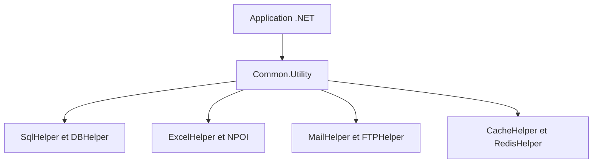

# laochiangx/Common.Utility

> Recueil de classes utilitaires C# (fichiers, e-mail, Excel, cache, base de données…), documenté surtout en chinois.

## Le problème
Les projets .NET réécrivent sans cesse les mêmes outils de base : manipulation de chaînes, fichiers, HTTP, chiffrement.

## Ce que ça fait vraiment
Le README ne présente que la liste des classes d'aide, par exemple `ADHelper`, `CacheHelper`, `ExcelHelper`, `FTPHelper`, `MailHelper`, `RedisHelper`, `MongoDBHelper`, `SqlHelper`, `QRcode` et `VideoConvert`, sans description d'usage. La documentation renvoie vers un article de blog et un fichier Sandcastle. Le comportement exact n'est pas documenté.

## Comment c'est branché

Schéma simplifié d'après la fiche, sans diagramme fourni.

## Essayer
Aucune commande documentée.

## Coût et pièges
Gratuit, mais aucune licence : l'usage n'est pas autorisé explicitement. Dernier push en décembre 2022. Il faut un environnement .NET (C#), pas Python.

## Ce que ce n'est pas
Ce n'est pas une bibliothèque publiée proprement : pas d'installation ni d'API décrites. Ce n'est pas un outil de data.

## Alternatives
Aucune alternative nommée dans le README.

## Pour toi
À ignorer : vrac de helpers C# sans licence, sans mode d'emploi, abandonné depuis 2022.

