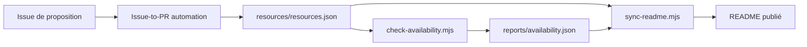

# laoma2053/awesome-zhuiju-free

> Chinese list of streaming sites, torrents, subtitles and IPTV sources, with availability status checked daily.

## The problem
Lists of links to TV-series sites rot quickly: changed domains, dead sites, overwhelming ads.

## What it actually does
A README (in Chinese) sorts resources by category: online streaming, apps, cloud-drive search, magnets/BT, subtitles, TVBox interfaces, IPTV sources, open source projects. Each line gets a "multi, fast, clean, stable" rating and a status (🟢/🟡/🔴). A GitHub Action checks every day whether the home page responds and rewrites the table. The repository says it does not host files or links to individual works.

## How it is wired

## Trying it
Nothing to install: read the README. The README cites `resources/resources.json` and `reports/availability.json` for the raw data.

## Cost and gotchas
Free. The README itself warns of copyright, security, privacy and payment risks depending on the sites, and many entries require a network workaround ("梯子"). The statuses reflect the state seen from GitHub Actions servers.

## What it is not
It is not a viewing service or a search engine. The listed sites have not been assessed for lawfulness; the README disclaims this in its warning.

## Alternatives
No alternative named in the README.

## For you
Ignore: off-topic for a data/AI/MLOps profile. Only the setup (JSON catalog, daily check, generated README) may inspire a living list.
