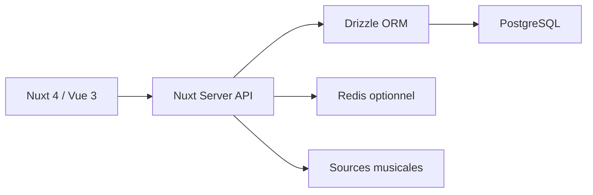

# laoshuikaixue/VoiceHub

> Nuxt 4 application for managing song requests for a school radio (README in Chinese).

## The problem
A campus radio needs to collect song requests, vote on them, schedule them and broadcast them, with role-based permissions.

## What it actually does
Handles requests and votes, scheduling with drafts and copy, request tickets, notifications, database backup, roles (super-admin, admin, music admin, user), 2FA, WebAuthn and OAuth. Searches go through NetEase, QQ Music and Bilibili. Stack: Nuxt 4, Drizzle, PostgreSQL, optional Redis.

## How it is wired


## Trying it
```bash
git clone https://github.com/laoshuikaixue/VoiceHub.git
cd VoiceHub
pnpm install --frozen-lockfile
cp .env.example .env
pnpm run deploy
pnpm run dev
```

## Cost and gotchas
PostgreSQL and a `JWT_SECRET` are required, Node 22.11+. The default admin account is `admin` / `admin123`: change it immediately. Depends on Chinese music services you do not control.

## What it is not
Not a mainstream music player. Downloads and music sources are school administration features.

## Alternatives
No alternative named in the README.

## For you
Ignore: a campus application in Chinese, unrelated to data / AI / MLOps.
