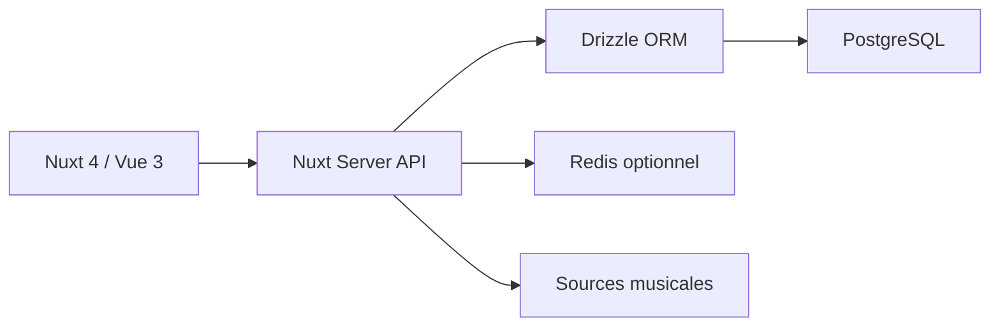

# laoshuikaixue/VoiceHub

> Application Nuxt 4 de gestion des demandes de morceaux pour une radio scolaire (README en chinois).

## Le problème
Une radio de campus doit collecter des demandes de morceaux, les voter, les planifier et les diffuser, avec des droits par rôle.

## Ce que ça fait vraiment
Gère demandes et votes, planning avec brouillons et copie, tickets de demande, notifications, sauvegarde de base, rôles (super-admin, admin, admin musique, utilisateur), 2FA, WebAuthn et OAuth. Les recherches passent par NetEase, QQ Music et Bilibili. Pile : Nuxt 4, Drizzle, PostgreSQL, Redis optionnel.

## Comment c'est branché


## Essayer
```bash
git clone https://github.com/laoshuikaixue/VoiceHub.git
cd VoiceHub
pnpm install --frozen-lockfile
cp .env.example .env
pnpm run deploy
pnpm run dev
```

## Coût et pièges
PostgreSQL et un `JWT_SECRET` obligatoires, Node 22.11+. Le compte admin par défaut est `admin` / `admin123` : à changer immédiatement. Dépend de services musicaux chinois non contrôlés.

## Ce que ce n'est pas
Pas un lecteur de musique grand public. Les téléchargements et sources musicales sont des fonctions d'administration scolaire.

## Alternatives
Aucune alternative nommée dans le README.

## Pour toi
À ignorer : application de campus en chinois, sans rapport avec data / IA / MLOps.

