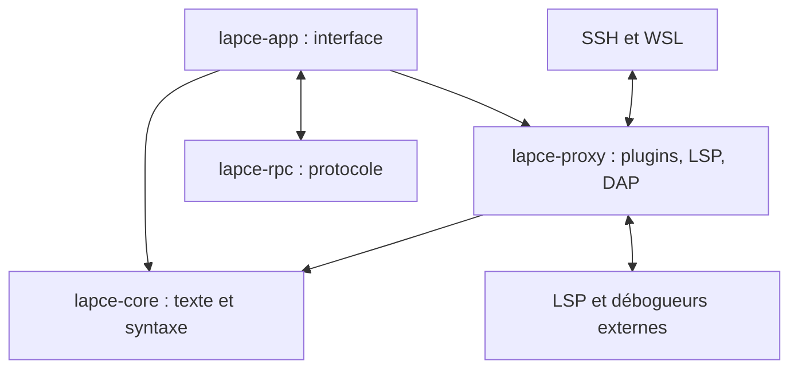

# lapce/lapce

> Code editor in Rust, with LSP, modal editing and remote development, for developers.

## The problem
Heavy web-based editors consume resources; people look for a native editor with language support.

## What it actually does
Floem interface, rendered with wgpu, text handled by ropes inspired by Xi-Editor. Built-in LSP (completion, diagnostics), optional Vim-style editing, built-in terminal, remote development inspired by VSCode Remote. Plugins compiled to WASI (C, Rust, AssemblyScript).

## How it is wired


## Trying it
```bash
# Aucune commande dans le README.
# Binaires pour Windows, Linux et macOS, ou gestionnaire de paquets.
```

## Cost and gotchas
Free. 911 open issues. Plugin ecosystem smaller than that of established editors (not documented, inferred from the project's size: to be verified).

## What it is not
Not a full IDE with out-of-the-box debugging: it relies on external LSP servers. No documented Jupyter notebooks.

## Alternatives
No alternative named in the README.

## For you
Worth watching: a curiosity for a fast editor, but the lack of documented notebooks and data plugins leaves it behind your current editor.
