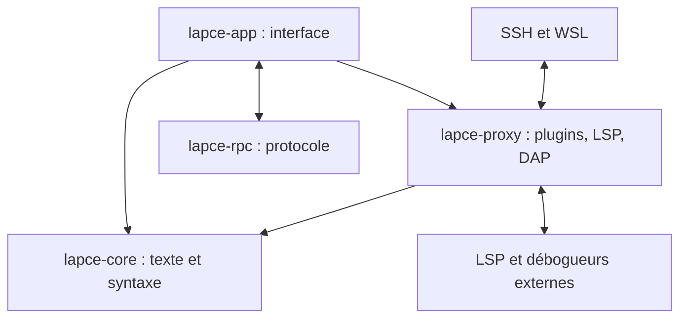

# lapce/lapce

> Éditeur de code en Rust, avec LSP, édition modale et développement distant, pour développeurs.

## Le problème
Les éditeurs web lourds consomment des ressources ; on cherche un éditeur natif avec support des langages.

## Ce que ça fait vraiment
Interface Floem, rendu avec wgpu, texte géré par des ropes inspirées de Xi-Editor. LSP intégré (complétion, diagnostics), édition type Vim activable, terminal intégré, développement distant inspiré de VSCode Remote. Plugins compilés en WASI (C, Rust, AssemblyScript).

## Comment c'est branché


## Essayer
```bash
# Aucune commande dans le README.
# Binaires pour Windows, Linux et macOS, ou gestionnaire de paquets.
```

## Coût et pièges
Gratuit. 911 issues ouvertes. Écosystème de plugins plus petit que celui des éditeurs établis (non documenté, déduit de la taille du projet : à vérifier).

## Ce que ce n'est pas
Pas un IDE complet avec débogage prêt à l'emploi : il s'appuie sur des serveurs LSP externes. Pas de notebooks Jupyter documentés.

## Alternatives
Aucune alternative nommée dans le README.

## Pour toi
À surveiller : curiosité pour un éditeur rapide, mais l'absence de notebooks et de plugins data documentés le laisse derrière ton éditeur actuel.

