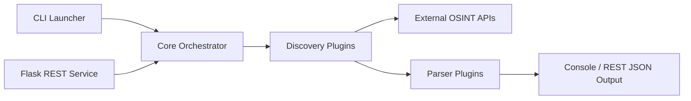

# laramies/theHarvester

> Open-source intelligence gathering on a domain, for the reconnaissance phase of an authorized assessment.

## The problem
Inventorying the subdomains, e-mail addresses and IPs associated with a domain requires querying many public sources and normalizing the results.

## What it actually does
Around sixty sources (search engines, certificate transparency, passive DNS, code repositories) are queried, and the normalized results are kept as evidence in a local SQLite database. Three interfaces share the same engine: CLI, REST API and HarvestView (local web interface, history, scheduling, tracking of hostname changes). Sources are classified P0 (passive), P1 (DNS queries), P2 (direct contact with the target); P1 and P2 require explicit selection.

## How it is wired


## Trying it
```bash
git clone https://github.com/laramies/theHarvester.git
cd theHarvester
uv sync
uv run theHarvester -d example.com -b crtsh,certspotter
```

## Cost and gotchas
Free, GPL-2.0. Requires Python 3.14 and uv. Some sources need an API key in `api-keys.yaml`. Even in passive mode, providers receive the target string. Keep HarvestView on the loopback interface; never commit keys or results.

## What it is not
The README requires running it only against targets you own or for which you have explicit authorization; P1/P2 actions must be covered by the authorized scope. A subdomain takeover hint is something to examine, not proof.

## Alternatives
- SpiderFoot: also covers people and identities, with more modules (not named in this README, given as a comparison from the same batch).

## For you
Worth watching: JSONL output and SQLite database usable in a pipeline, useful if you do exposure inventory; otherwise outside your core field.
