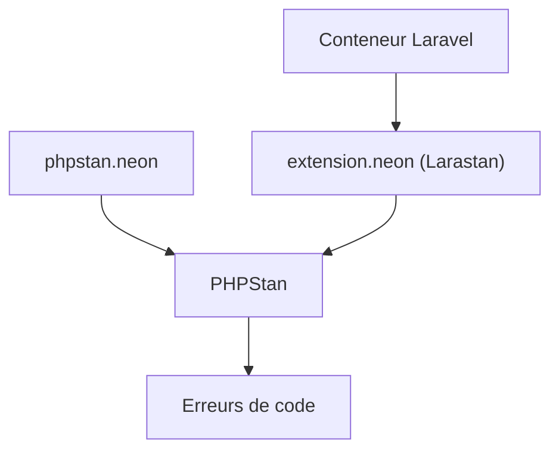

# larastan/larastan

> PHPStan extension for Laravel that catches bugs before tests, aimed at PHP developers.

## The problem
Laravel's "magic" makes PHP static analysis blind to many types and possible errors.

## What it actually does
Adds Laravel understanding to PHPStan. Larastan boots the application container to resolve types computed at runtime. It is installed as a development dependency and configured through `phpstan.neon`. Strictness levels from 0 to 10, a baseline for legacy code. Requires PHP 8.2+ and Laravel 11.15+.

## How it is wired
Simplified diagram based on the sheet, no diagram provided.



## Trying it
```bash
composer require --dev "larastan/larastan:^3.0"
./vendor/bin/phpstan analyse
./vendor/bin/phpstan analyse --memory-limit=2G
./vendor/bin/phpstan analyse --generate-baseline
```

## Cost and gotchas
Free. Analysis can run out of memory (`--memory-limit` option). Some parts of Laravel remain too magical and known errors have to be ignored.

## What it is not
Not purely static analysis: the application is booted. Only useful for Laravel.

## Alternatives
No alternative named in the README; it builds on PHPStan.

## For you
Ignore: reserved for PHP/Laravel projects, no use for a data / AI / MLOps profile.
