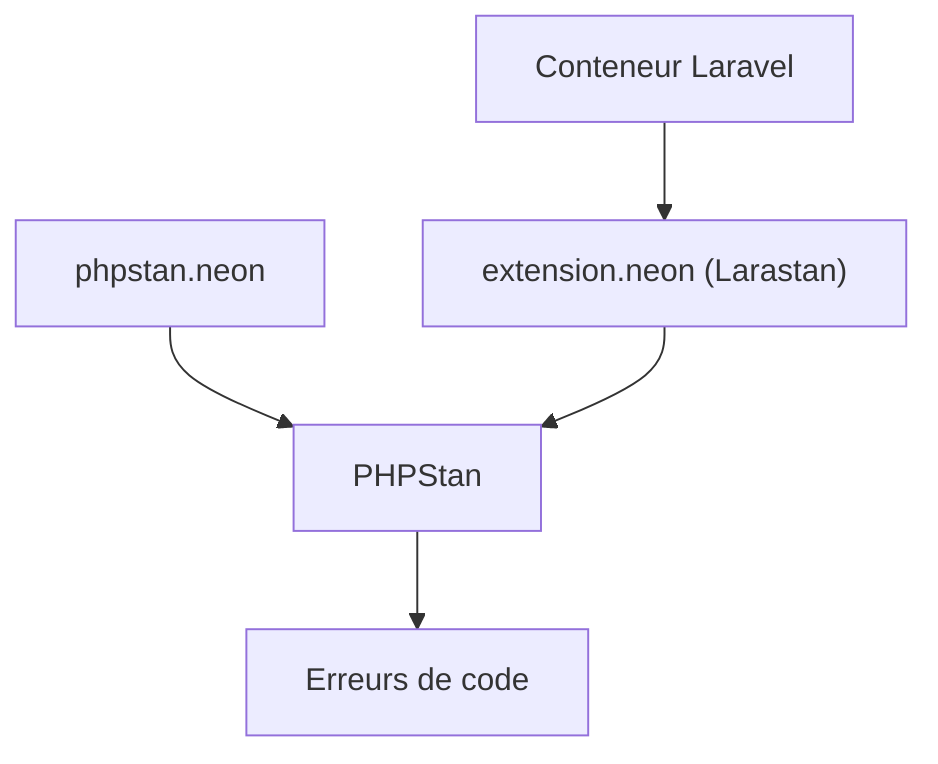

# larastan/larastan

> Extension PHPStan pour Laravel qui détecte des bugs avant les tests, destinée aux développeurs PHP.

## Le problème
La « magie » de Laravel rend l'analyse statique de PHP aveugle à de nombreux types et erreurs possibles.

## Ce que ça fait vraiment
Ajoute à PHPStan la compréhension de Laravel. Larastan démarre le conteneur de l'application pour résoudre les types calculés à l'exécution. Il s'installe en dépendance de développement et se configure par `phpstan.neon`. Niveaux de rigueur de 0 à 10, baseline pour du code ancien. Requiert PHP 8.2+ et Laravel 11.15+.

## Comment c'est branché
Schéma simplifié d'après la fiche, sans diagramme fourni.



## Essayer
```bash
composer require --dev "larastan/larastan:^3.0"
./vendor/bin/phpstan analyse
./vendor/bin/phpstan analyse --memory-limit=2G
./vendor/bin/phpstan analyse --generate-baseline
```

## Coût et pièges
Gratuit. L'analyse peut dépasser la mémoire (option `--memory-limit`). Certaines parties de Laravel restent trop magiques et il faut ignorer des erreurs connues.

## Ce que ce n'est pas
Pas une analyse purement statique : l'application est démarrée. Ne sert que pour Laravel.

## Alternatives
Aucune alternative nommée dans le README ; il s'appuie sur PHPStan.

## Pour toi
À ignorer : réservé aux projets PHP/Laravel, sans usage pour un profil data / IA / MLOps.

