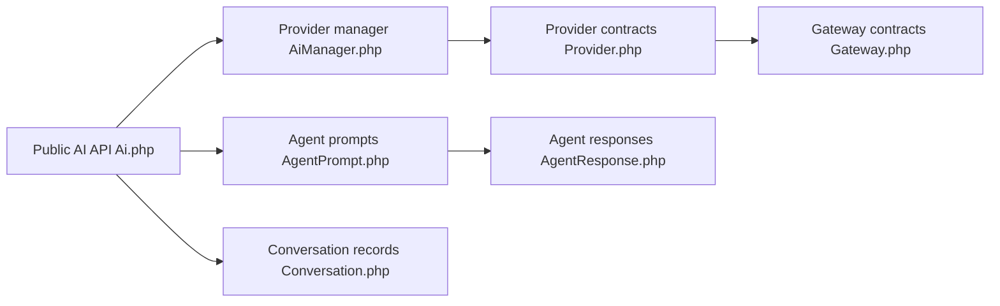

# laravel/ai

> Laravel SDK for calling AI providers through a unified API: agents, images, audio, embeddings.

## The problem
Each AI provider has its own API, which makes switching models in a Laravel app complicated.

## What it actually does
Minimal README: it points to the documentation on the Laravel site. From the code: public API, provider manager, per-provider gateways, agents with tools, streaming, structured output, approvals, persisted conversations, images, audio, transcription, embeddings and files.

## How it is wired

## Trying it
No command documented in the README: refer to the documentation on the Laravel site.

## Cost and gotchas
API keys for each provider are at your expense (OpenAI, Anthropic, Gemini mentioned). README under 800 characters: little verifiable information here.

## What it is not
Not a model nor a hosted platform: it is an abstraction layer inside a Laravel app.

## Alternatives
No alternative named in the README.

## For you
Watch: relevant only for a PHP/Laravel stack; otherwise nothing for you, and the assessment remains partial for lack of a detailed README.
