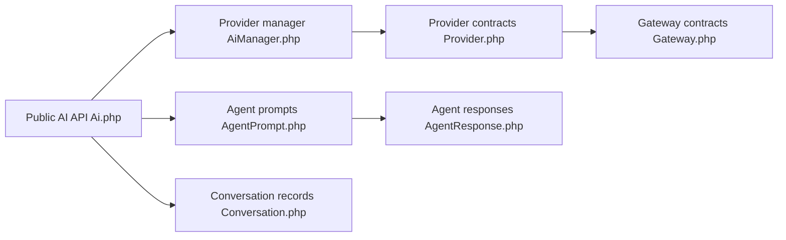

# laravel/ai

> SDK Laravel pour appeler des fournisseurs d'IA via une API unifiée : agents, images, audio, embeddings.

## Le problème
Chaque fournisseur d'IA a son API, ce qui complique le changement de modèle dans une appli Laravel.

## Ce que ça fait vraiment
README minimal : il renvoie à la documentation du site Laravel. D'après le code : API publique, gestionnaire de fournisseurs, passerelles par fournisseur, agents avec outils, streaming, sortie structurée, approbations, conversations persistées, images, audio, transcription, embeddings et fichiers.

## Comment c'est branché

## Essayer
Aucune commande documentée dans le README : se reporter à la documentation sur le site Laravel.

## Coût et pièges
Clés d'API de chaque fournisseur à ta charge (OpenAI, Anthropic, Gemini cités). README de moins de 800 caractères : peu d'informations vérifiables ici.

## Ce que ce n'est pas
Pas un modèle ni une plateforme hébergée : c'est une couche d'abstraction dans une appli Laravel.

## Alternatives
Aucune alternative nommée dans le README.

## Pour toi
Surveiller : pertinent seulement pour une stack PHP/Laravel ; sinon rien pour toi, et l'évaluation reste partielle faute de README détaillé.

