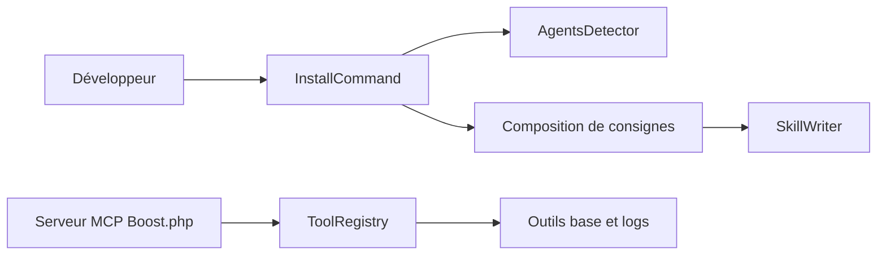

# laravel/boost

> Laravel package that gives AI assistants project-specific guidelines, skills and an MCP server.

## The problem
Code assistants generate generic Laravel, without knowing the version, conventions or structure of the application.

## What it actually does
Minimal README: it points to the official documentation. Based on the architecture described from the code: an install command detects AI agents, composes guidelines, rules and skills, then writes the configuration. An MCP server exposes tools and prompts (database schema, log reading, upgrades).

## How it is wired


## Trying it
```bash
# Aucune commande dans le README fourni ;
# voir la documentation officielle sur le site de Laravel.
```

## Cost and gotchas
Free and official; installation is a PHP package, not pip despite the imposed list of values (no other value is exact). Details are not in the README.

## What it is not
Not an agent or a model: it prepares context for the ones you already use. Usable only within a Laravel project.

## Alternatives
- No alternative named in the README.

## For you
Ignore: reserved for Laravel/PHP projects; its only interest is showing how a framework prepares its guidelines and MCP server for agents.
