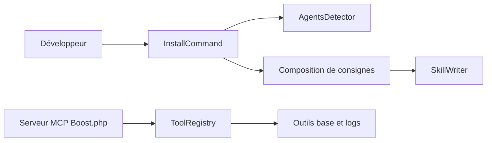

# laravel/boost

> Paquet Laravel qui fournit aux assistants IA des consignes, des skills et un serveur MCP propres au projet.

## Le problème
Les assistants de code génèrent du Laravel générique, sans connaître la version, les conventions ni la structure de l'application.

## Ce que ça fait vraiment
README minimal : il renvoie à la documentation officielle. D'après l'architecture décrite d'après le code : une commande d'installation détecte les agents IA, compose les consignes, règles et skills puis écrit la configuration. Un serveur MCP expose outils et prompts (schéma de base de données, lecture des logs, mises à niveau).

## Comment c'est branché


## Essayer
```bash
# Aucune commande dans le README fourni ;
# voir la documentation officielle sur le site de Laravel.
```

## Coût et pièges
Gratuit et officiel ; l'installation est un paquet PHP, non pip malgré la liste de valeurs imposée (aucune autre valeur n'est exacte). Les détails ne figurent pas dans le README.

## Ce que ce n'est pas
Pas un agent ni un modèle : il prépare le contexte pour ceux que tu utilises déjà. Utilisable seulement dans un projet Laravel.

## Alternatives
- Aucune alternative nommée dans le README.

## Pour toi
À ignorer : réservé aux projets Laravel/PHP ; son seul intérêt est de montrer comment un framework prépare ses guidelines et son serveur MCP pour les agents.

