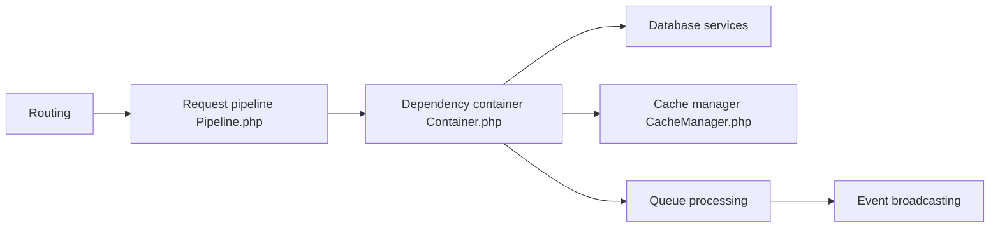

# laravel/framework

> Core of the Laravel PHP web framework: routing, dependency injection container, queues and event broadcasting.

## The problem
Building a PHP web application without rewriting routing, database access, queues and cache.

## What it actually does
Receives an HTTP request, passes it through middlewares and services, returns a response. Provides a dependency container, configuration, facades, schema migrations, filesystem, cache, job queues and real-time event broadcasting. This repository is the core; to create an application, the README points to the main Laravel repository.

## How it is wired

## Trying it
No command documented in the README.

## Cost and gotchas
Free. This repository is not an application skeleton to clone.

## What it is not
Not an application nor a data tool: it is the base library of a web framework.

## Alternatives
No alternative named in the README.

## For you
Ignore: a PHP framework unrelated to data/AI/MLOps work.
