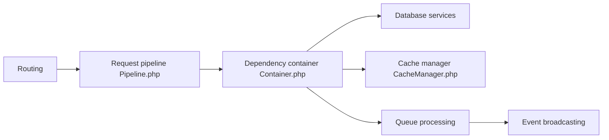

# laravel/framework

> Cœur du framework web PHP Laravel : routage, conteneur d'injection, files et diffusion d'événements.

## Le problème
Construire une application web PHP sans réécrire routage, base de données, files et cache.

## Ce que ça fait vraiment
Reçoit une requête HTTP, la fait passer par des middlewares et des services, renvoie une réponse. Fournit conteneur de dépendances, configuration, facades, migrations de schéma, système de fichiers, cache, files de tâches et diffusion d'événements en temps réel. Ce dépôt est le cœur ; pour créer une application, le README renvoie au dépôt principal Laravel.

## Comment c'est branché

## Essayer
Aucune commande documentée dans le README.

## Coût et pièges
Gratuit. Ce dépôt n'est pas un squelette d'application à cloner.

## Ce que ce n'est pas
Pas une application ni un outil data : c'est la bibliothèque de base d'un framework web.

## Alternatives
Aucune alternative nommée dans le README.

## Pour toi
À ignorer : framework PHP sans lien avec le travail data/IA/MLOps.

