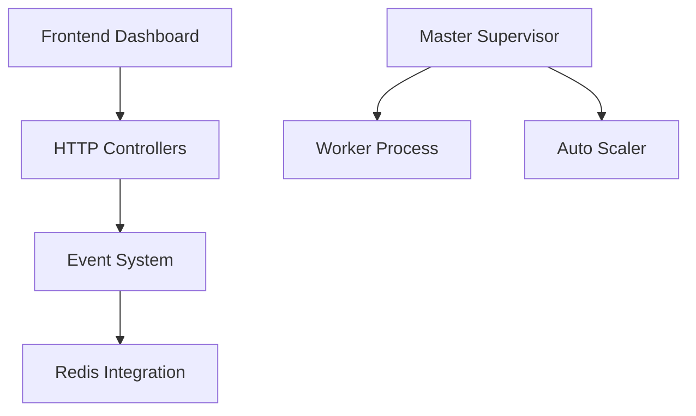

# laravel/horizon

> Dashboard and code-based configuration for the Redis queues of a Laravel application.

## The problem
Queue workers run with no visibility: throughput, duration and job failures remain opaque.

## What it actually does
Horizon displays a Vue.js dashboard on Laravel's Redis queues: throughput, execution time and failures. The whole worker configuration fits in a versioned file. According to the architecture, a MasterSupervisor launches supervisors and workers, an AutoScaler adjusts their number and Redis repositories store jobs and metrics.

## How it is wired

## Trying it
No command documented in the README: see the documentation on the Laravel website.

## Cost and gotchas
Free, but you need a Laravel application and a Redis server.

## What it is not
It is not a queue system: it supervises Laravel's. It only works with Redis, not with other queue drivers.

## Alternatives
No alternative named in the README.

## For you
Ignore: reserved for the PHP Laravel ecosystem, unrelated to your data / AI pipelines.
