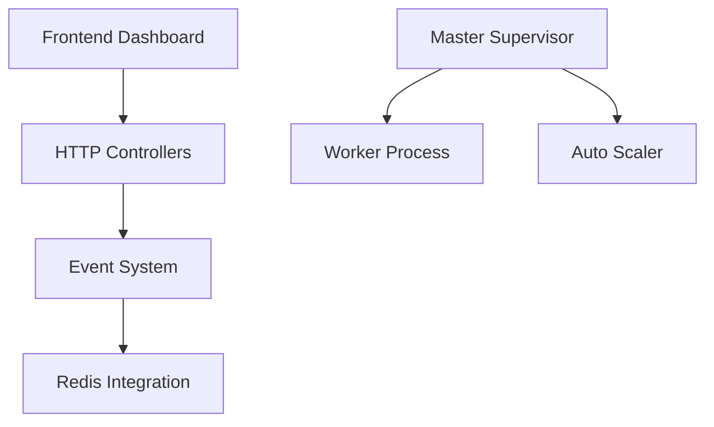

# laravel/horizon

> Tableau de bord et configuration par code pour les files Redis d'une application Laravel.

## Le problème
Les workers de file d'attente tournent sans visibilité : débit, durée et échecs des tâches restent opaques.

## Ce que ça fait vraiment
Horizon affiche un tableau de bord Vue.js sur les files Redis de Laravel : débit, temps d'exécution et échecs. Toute la configuration des workers tient dans un fichier versionné. D'après l'architecture, un MasterSupervisor lance des superviseurs et des workers, un AutoScaler ajuste leur nombre et des dépôts Redis stockent tâches et métriques.

## Comment c'est branché

## Essayer
Aucune commande documentée dans le README : voir la documentation sur le site de Laravel.

## Coût et pièges
Gratuit, mais il faut une application Laravel et un serveur Redis.

## Ce que ce n'est pas
Ce n'est pas un système de files : il supervise celui de Laravel. Il ne fonctionne qu'avec Redis, pas avec d'autres pilotes de file.

## Alternatives
Aucune alternative nommée dans le README.

## Pour toi
Ignorer : réservé à l'écosystème PHP Laravel, sans lien avec tes pipelines data / IA.

