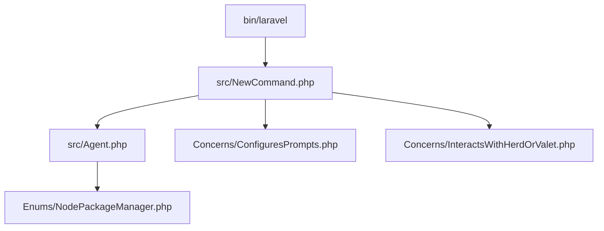

# laravel/installer

> Official command-line installer that creates new Laravel applications.

## The problem
Starting a Laravel project requires choosing a version, a package manager and a local environment.

## What it actually does
The README contains only links to the documentation. Based on the code's architecture, `bin/laravel` launches `NewCommand`, which delegates to `Agent`; it handles interactive questions, Herd or Valet and the choice of Node package manager. Fixtures cover Laravel 10 to 12.

## How it is wired
Diagram based on the code's diagram.

## Trying it
No command documented in the README: see the Laravel installation documentation.

## Cost and gotchas
Free. Requires PHP and Composer; the real need is not in the prerequisites list. Very thin README material.

## What it is not
Not the Laravel framework itself: only the tool that generates a project.

## Alternatives
No alternative named in the README.

## For you
Ignore: a PHP tool for creating web applications, outside the data / AI / MLOps scope.
