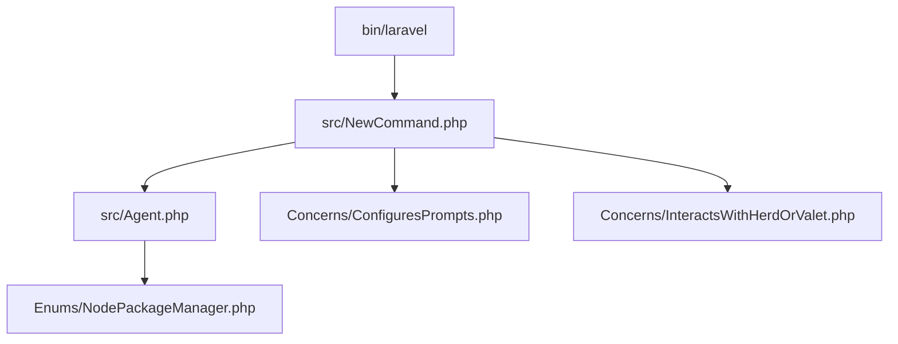

# laravel/installer

> Installeur en ligne de commande officiel qui crée de nouvelles applications Laravel.

## Le problème
Démarrer un projet Laravel demande de choisir version, gestionnaire de paquets et environnement local.

## Ce que ça fait vraiment
Le README ne contient que des renvois vers la documentation. D'après l'architecture du code, `bin/laravel` lance `NewCommand`, qui délègue à `Agent` ; il gère les questions interactives, Herd ou Valet et le choix du gestionnaire Node. Des fixtures couvrent Laravel 10 à 12.

## Comment c'est branché
Schéma d'après le diagramme du code.

## Essayer
Aucune commande documentée dans le README : voir la documentation d'installation de Laravel.

## Coût et pièges
Gratuit. Nécessite PHP et Composer ; le besoin réel n'est pas dans la liste des prérequis. Matière du README très mince.

## Ce que ce n'est pas
Pas le framework Laravel lui-même : seulement l'outil qui génère un projet.

## Alternatives
Aucune alternative nommée dans le README.

## Pour toi
À ignorer : outil PHP pour créer des applications web, hors du périmètre data / IA / MLOps.

