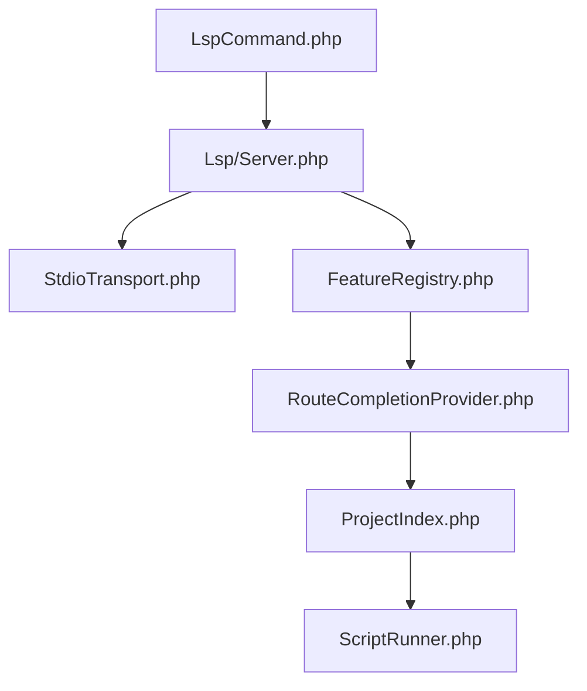

# laravel/lsp

> LSP server that brings completion, hover and diagnostics to Laravel and Blade in the editor.

## The problem
Editors do not know the routes, views, configs and bindings specific to Laravel.

## What it actually does
An LSP server (stdio) that indexes the project with PHP scripts, then provides completions, hovers, links, diagnostics and actions for routes, Blade views, translations, config, environment variables, Inertia, Livewire, middleware, Eloquent. Everything is configured through `initializationOptions`.

## How it is wired


## Trying it
```bash
composer global require laravel/lsp
```

## Cost and gotchas
Requires PHP and Composer, a `PATH` including the global bin; Neovim 0.11+ for manual configuration. The server runs the project's PHP (Herd, Sail, DDEV…). License: none declared.

## What it is not
Not a linter nor a framework: it does not run the application, it indexes it for the editor.

## Alternatives
No alternative named in the README.

## For you
Ignore: Laravel/PHP tooling, no link to data/AI/MLOps.
