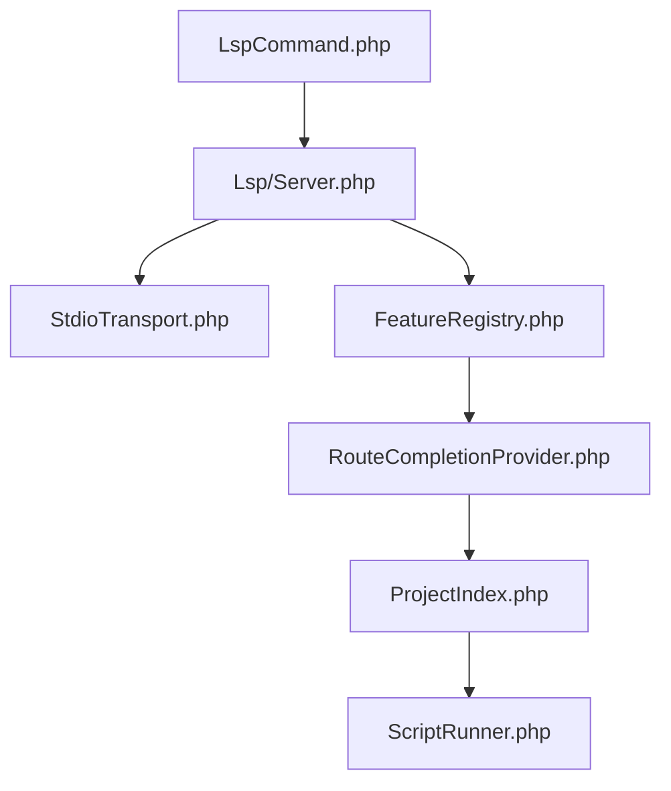

# laravel/lsp

> Serveur LSP qui apporte complétion, survol et diagnostics à Laravel et Blade dans l'éditeur.

## Le problème
Les éditeurs ne connaissent pas les routes, vues, configs et bindings propres à Laravel.

## Ce que ça fait vraiment
Un serveur LSP (stdio) qui indexe le projet avec des scripts PHP, puis fournit complétions, survols, liens, diagnostics et actions pour routes, vues Blade, traductions, config, variables d'environnement, Inertia, Livewire, middleware, Eloquent. Tout se règle par `initializationOptions`.

## Comment c'est branché


## Essayer
```bash
composer global require laravel/lsp
```

## Coût et pièges
Demande PHP et Composer, un `PATH` incluant le bin global ; Neovim 0.11+ pour la config manuelle. Le serveur lance du PHP du projet (Herd, Sail, DDEV…). Licence : aucune déclarée.

## Ce que ce n'est pas
Pas un linter ni un framework : il n'exécute pas l'application, il l'indexe pour l'éditeur.

## Alternatives
Aucune alternative nommée dans le README.

## Pour toi
Ignorer : outillage Laravel/PHP, sans lien avec data/IA/MLOps.

