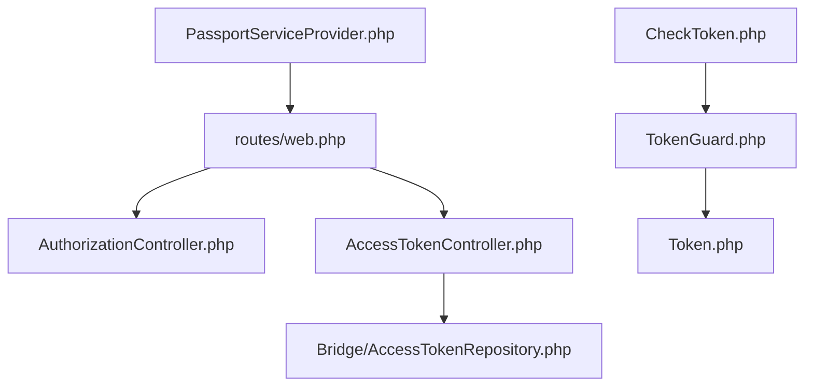

# laravel/passport

> OAuth2 server and API authentication for Laravel applications.

## The problem
Protecting a Laravel API with OAuth2 tokens means implementing authorization, clients and tokens yourself.

## What it actually does
A service provider declares the OAuth2 routes and configuration. The authorization and token controllers rely on the repositories in the Bridge folder (League OAuth2) that read clients and tokens from the database. A TokenGuard and a CheckToken middleware validate the tokens. Minimal README: the details are on the Laravel site.

## How it is wired

## Trying it
No command in the README: the documentation is on the Laravel site.

## Cost and gotchas
Free. Requires a Laravel (PHP) project and a database, outside the prerequisites list.

## What it is not
Not a framework-independent identity provider: it is tied to Laravel.

## Alternatives
No alternative cited in the README.

## For you
Ignore: relevant only if your API is in Laravel, not for a Python data or AI backend.
