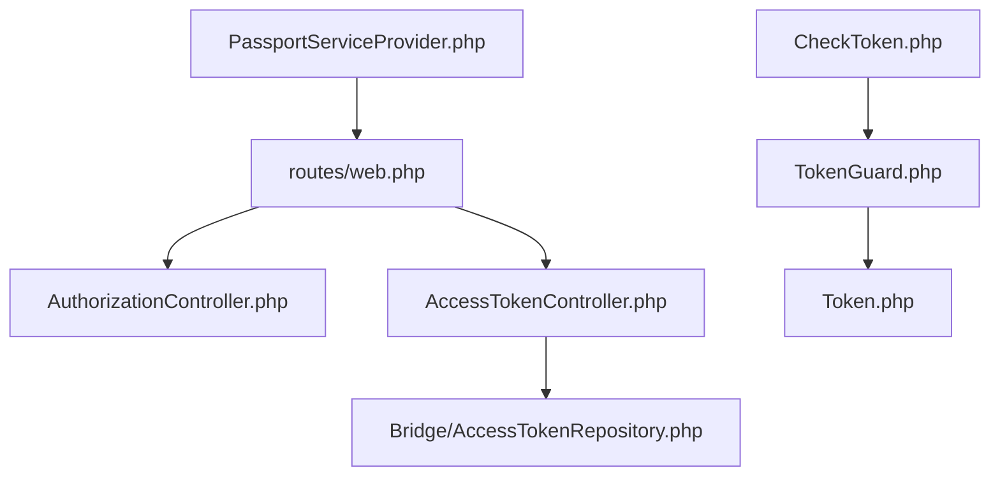

# laravel/passport

> Serveur OAuth2 et authentification d'API pour les applications Laravel.

## Le problème
Protéger une API Laravel par des jetons OAuth2 demande d'implémenter soi-même autorisation, clients et jetons.

## Ce que ça fait vraiment
Un service provider déclare les routes OAuth2 et la configuration. Les contrôleurs d'autorisation et de jeton s'appuient sur les dépôts du dossier Bridge (League OAuth2) qui lisent clients et jetons en base. Un TokenGuard et un middleware CheckToken valident les jetons. README minimal : le détail est sur le site Laravel.

## Comment c'est branché

## Essayer
Aucune commande dans le README : la documentation est sur le site Laravel.

## Coût et pièges
Gratuit. Exige un projet Laravel (PHP) et une base de données, hors liste de prérequis.

## Ce que ce n'est pas
Pas un fournisseur d'identité indépendant du framework : il est lié à Laravel.

## Alternatives
Aucune alternative citée dans le README.

## Pour toi
Ignorer : pertinent seulement si ton API est en Laravel, pas pour un backend data ou IA en Python.

