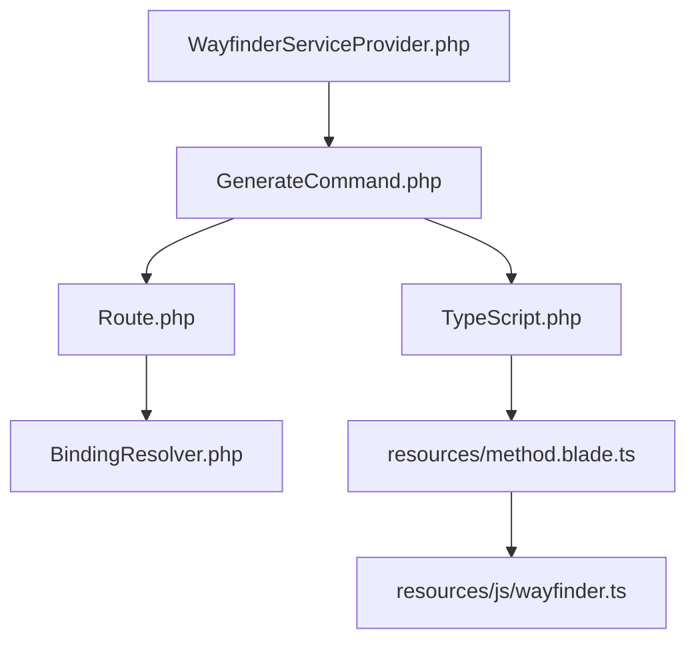

# laravel/wayfinder

> Laravel package that generates typed TypeScript functions to call its routes and controllers.

## The problem
Hand-writing route URLs and parameters on the client side quickly drifts out of sync with the backend.

## What it actually does
`wayfinder:generate` reads the Laravel routes, resolves model bindings and generates TypeScript functions (`show(1)` returns URL and method), via Blade templates. A Vite plugin regenerates on every change. Supports forms, query options and Inertia.

## How it is wired


## Trying it
```bash
composer require laravel/wayfinder
npm i -D @laravel/vite-plugin-wayfinder
php artisan wayfinder:generate
```

## Cost and gotchas
Free (MIT). In beta: the API may change before 1.0. A stale route cache makes generation fail: run `php artisan route:clear` before the build.

## What it is not
Not an HTTP client: it only produces URL and method. Laravel only.

## Alternatives
No alternative named in the README.

## For you
Ignore: Laravel and TypeScript tooling, unrelated to a data / AI / MLOps profile.
