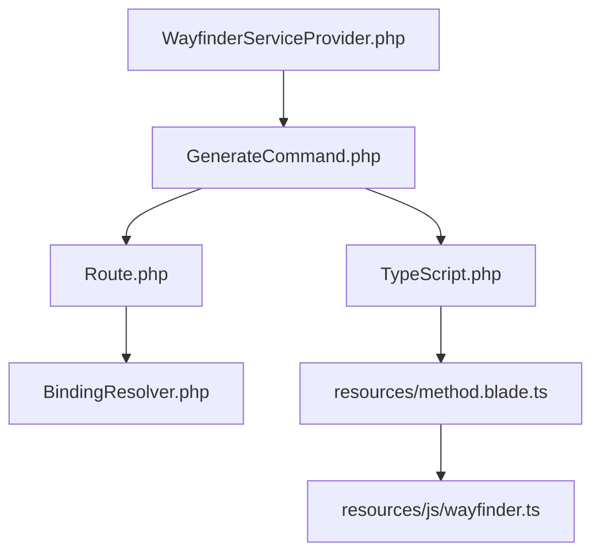

# laravel/wayfinder

> Paquet Laravel qui génère des fonctions TypeScript typées pour appeler ses routes et contrôleurs.

## Le problème
Écrire à la main les URL et paramètres de route côté client se désynchronise vite du backend.

## Ce que ça fait vraiment
`wayfinder:generate` lit les routes Laravel, résout les liaisons de modèles et génère des fonctions TypeScript (`show(1)` renvoie URL et méthode), via des gabarits Blade. Un plugin Vite régénère à chaque changement. Support de formulaires, d'options de requête et d'Inertia.

## Comment c'est branché


## Essayer
```bash
composer require laravel/wayfinder
npm i -D @laravel/vite-plugin-wayfinder
php artisan wayfinder:generate
```

## Coût et pièges
Gratuit (MIT). En bêta : l'API peut changer avant la 1.0. Un cache de routes périmé fait échouer la génération : lancer `php artisan route:clear` avant le build.

## Ce que ce n'est pas
Pas un client HTTP : il ne fait que produire URL et méthode. Réservé à Laravel.

## Alternatives
Aucune alternative nommée dans le README.

## Pour toi
À ignorer : outillage Laravel et TypeScript, sans rapport avec un profil data / IA / MLOps.

