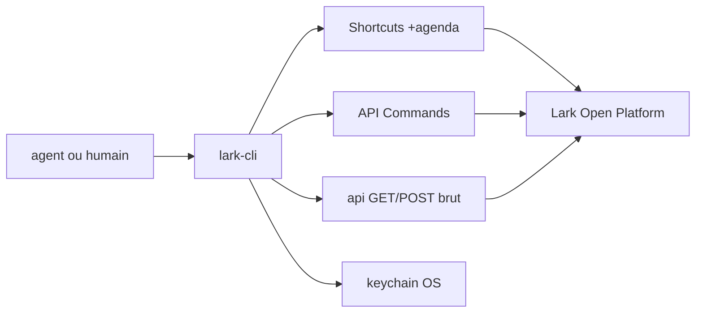

# larksuite/cli

> Official Lark/Feishu CLI, designed to be driven by an agent as much as by a human.

## The problem
Driving Lark/Feishu from a script forces you to write the OAuth auth, the pagination and the mapping of the 2500+ Open Platform endpoints yourself.

## What it actually does
Exposes 18 business domains (Messenger, Docs, Base, Sheets, Slides, Calendar, Mail, Tasks, Meetings, Wiki, OKR…) in 200+ commands. Three levels of granularity: `+xxx` shortcuts, API commands generated from the OAPI metadata, and a raw call `lark-cli api GET /open-apis/...`. Ships 26 "Agent Skills" (`lark-calendar`, `lark-im`, `lark-base`…) that an agent can load. Output as json/pretty/table/ndjson/csv with a distinct success/error envelope, `--dry-run`, `--page-all`.

## How it is wired


## Trying it
```bash
npx @larksuite/cli@latest install
lark-cli config init
lark-cli auth login --recommend
lark-cli calendar +agenda
```

## Cost and gotchas
Free (MIT) but useless without a Lark/Feishu tenant: you must create an app and authorize it. By default the CLI sends risk-control signals (OS, machine model); `lark-cli config risk-control off` turns them off.

## What it is not
Not a universal messaging client: it is Lark/Feishu only. The README itself warns that letting an agent act under your identity can expose sensitive data (hallucination, prompt injection), and advises against adding the bot to groups.

## Alternatives
- `meegle-cli`: the Project/Meegle domain, to be installed separately.
- No other alternative named in the README.

## For you
Without a Lark tenant, irrelevant. Ignore it unless your company is on Feishu.
