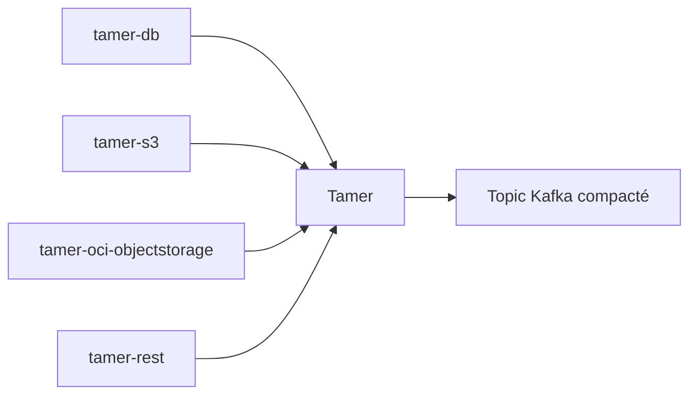

# laserdisc-io/tamer

> Scala library that ingests SQL, S3 or REST into Kafka while keeping control of the state.

## The problem
Generic Kafka connectors leave little control over the read window and the state kept. Hard to fine-tune ingestion.

## What it actually does
Kafka source connector where the user decides, at each "pull", what comes next (widen or narrow the window, slow down). State is kept in a compacted Kafka topic. Four sources: SQL via Doobie, S3-compatible storage, OCI Object Storage, REST API (authentication, pagination, HATEOAS).

## How it is wired
Simplified diagram based on the sheet, no diagram provided.



## Trying it
```bash
# Depuis le dossier db/local (Docker requis)
docker compose up
# puis lancer l'exemple
./runDatabaseSimple.sh
# interface Kafka : http://localhost:8000
```

## Cost and gotchas
Free. Requires Scala/sbt (the prerequisites list has no value for this) and Docker for end-to-end tests. A Kafka cluster is needed.

## What it is not
Not a ready-to-configure Kafka Connect connector: it is a library to integrate into a Scala application.

## Alternatives
No alternative named in the README.

## For you
Worth watching: useful if you do Kafka ingestion in Scala, outside your usual Python scope.
