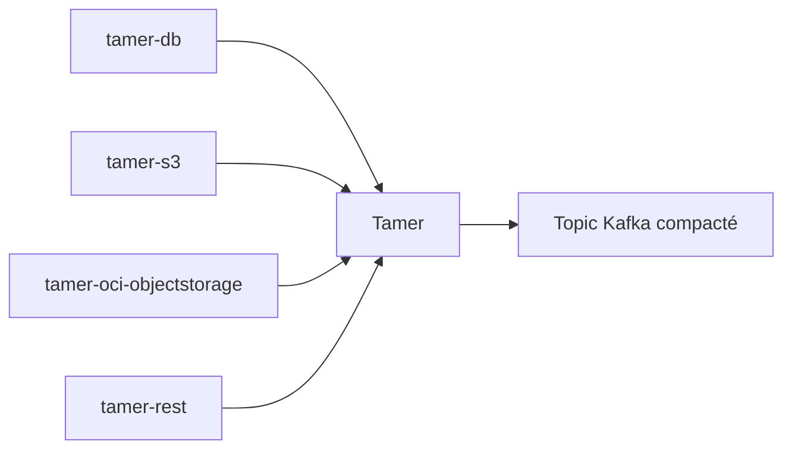

# laserdisc-io/tamer

> Bibliothèque Scala qui ingère SQL, S3 ou REST vers Kafka en gardant la main sur l'état.

## Le problème
Les connecteurs Kafka génériques laissent peu de contrôle sur la fenêtre de lecture et l'état conservé. Difficile d'adapter finement l'ingestion.

## Ce que ça fait vraiment
Connecteur source Kafka où l'utilisateur décide, à chaque « pull », de la suite (élargir ou réduire la fenêtre, ralentir). L'état est gardé dans un topic Kafka compacté. Quatre sources : SQL via Doobie, stockage compatible S3, OCI Object Storage, API REST (authentification, pagination, HATEOAS).

## Comment c'est branché
Schéma simplifié d'après la fiche, sans diagramme fourni.



## Essayer
```bash
# Depuis le dossier db/local (Docker requis)
docker compose up
# puis lancer l'exemple
./runDatabaseSimple.sh
# interface Kafka : http://localhost:8000
```

## Coût et pièges
Gratuit. Demande Scala/sbt (la liste de prérequis n'a pas de valeur pour cela) et Docker pour les tests de bout en bout. Un cluster Kafka est nécessaire.

## Ce que ce n'est pas
Ce n'est pas un connecteur Kafka Connect prêt à configurer : c'est une bibliothèque à intégrer dans une application Scala.

## Alternatives
Aucune alternative nommée dans le README.

## Pour toi
À surveiller : utile si tu fais de l'ingestion Kafka en Scala, hors de ton périmètre Python habituel.

