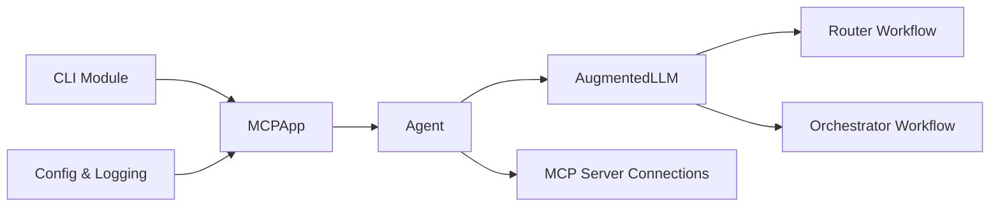

# lastmile-ai/mcp-agent

> Python framework for building agents on the Model Context Protocol with composable patterns.

## The problem
Connecting an agent to several MCP servers means handling connection lifecycle, tools, state and crash recovery.

## What it actually does
`MCPApp` loads configuration, logs and the execution engine; an `Agent` declares its MCP servers; an `AugmentedLLM` (OpenAI, Anthropic, Google, Azure, Bedrock) exposes `generate_str` and `generate_structured`. Ready-made patterns: parallel, router, intent classifier, orchestrator, deep research, evaluator-optimizer, swarm. Switch to Temporal for durability without changing the code; an app can expose itself as an MCP server.

## How it is wired


## Trying it
```bash
uvx mcp-agent init
uv add "mcp-agent[openai]"
uv run main.py
pip install mcp-agent
uvx mcp-agent deploy my-agent
```

## Cost and gotchas
LLM provider key at your expense; deploying to mcp-agent Cloud requires an account (`uvx mcp-agent login`). Temporal adds a worker to operate.

## What it is not
Not a finished product nor a graphical interface: a code library. Last push in January 2026, 138 open issues.

## Alternatives
No named alternative; OpenAI Swarm is only cited for compatibility with the swarm pattern.

## For you
Worth watching: a clean approach (Anthropic's patterns, Temporal durability, native MCP) if you build tool-equipped agents, but the slowed commit pace suggests waiting before making it a foundation.
