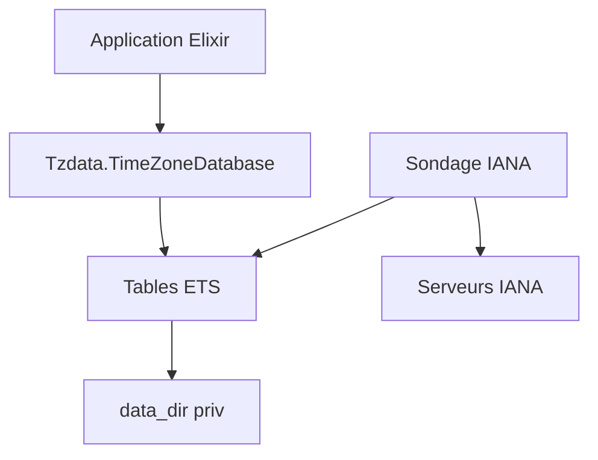

# lau/tzdata

> IANA time zone database for Elixir, updated automatically at runtime.

## The problem
Local time calculations need an up-to-date time zone database, otherwise rule changes throw dates off.

## What it actually does
Provides the tz database (version 2026d) to Elixir's standard library through `Tzdata.TimeZoneDatabase`. It queries the IANA servers, downloads new versions and stores them in ETS tables in a configurable data directory. With OTP 25 or later, it uses the built-in `httpc` client.

## How it is wired
Simplified diagram based on the sheet, no diagram provided.



## Trying it
```elixir
{:tzdata, "~> 1.2"}
config :elixir, :time_zone_database, Tzdata.TimeZoneDatabase
DateTime.now("Europe/Copenhagen")
```
First block to add in `deps` of the `mix.exs` file.

## Cost and gotchas
Elixir 1.12+ and OTP 25 recommended. For a release, you need a writable data directory and must copy `release_ets` into it. The automatic download goes out to the network.

## What it is not
Not usable outside Elixir. Hackney is no longer required and its support is deprecated.

## Alternatives
No alternative named in the README.

## For you
Ignore: very specialized Elixir library, only useful if your services are in Elixir.
