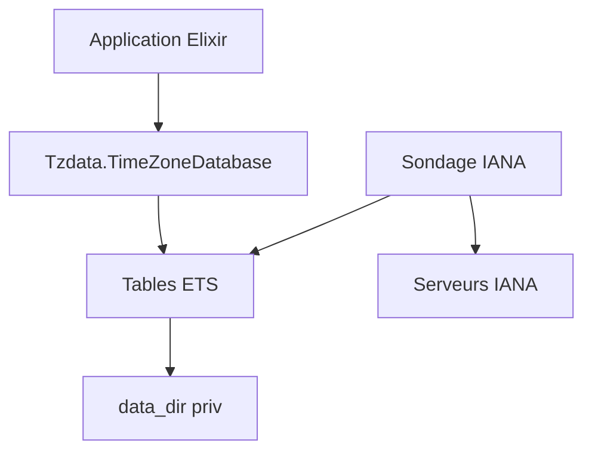

# lau/tzdata

> Base de fuseaux horaires IANA pour Elixir, mise à jour automatiquement à l'exécution.

## Le problème
Les calculs d'heure locale demandent une base de fuseaux à jour, sinon les changements de règles faussent les dates.

## Ce que ça fait vraiment
Fournit la base tz (version 2026d) à la bibliothèque standard d'Elixir via `Tzdata.TimeZoneDatabase`. Elle interroge les serveurs IANA, télécharge les nouvelles versions et les stocke en tables ETS dans un répertoire de données configurable. Avec OTP 25 ou plus, elle utilise le client `httpc` intégré.

## Comment c'est branché
Schéma simplifié d'après la fiche, sans diagramme fourni.



## Essayer
```elixir
{:tzdata, "~> 1.2"}
config :elixir, :time_zone_database, Tzdata.TimeZoneDatabase
DateTime.now("Europe/Copenhagen")
```
Premier bloc à ajouter dans `deps` du fichier `mix.exs`.

## Coût et pièges
Elixir 1.12+ et OTP 25 conseillé. Pour une release, il faut un répertoire de données accessible en écriture et y copier `release_ets`. Le téléchargement automatique sort vers le réseau.

## Ce que ce n'est pas
Pas utilisable hors d'Elixir. Hackney n'est plus requis et son support est déprécié.

## Alternatives
Aucune alternative nommée dans le README.

## Pour toi
Ignorer : bibliothèque Elixir très spécialisée, utile seulement si tes services sont en Elixir.

