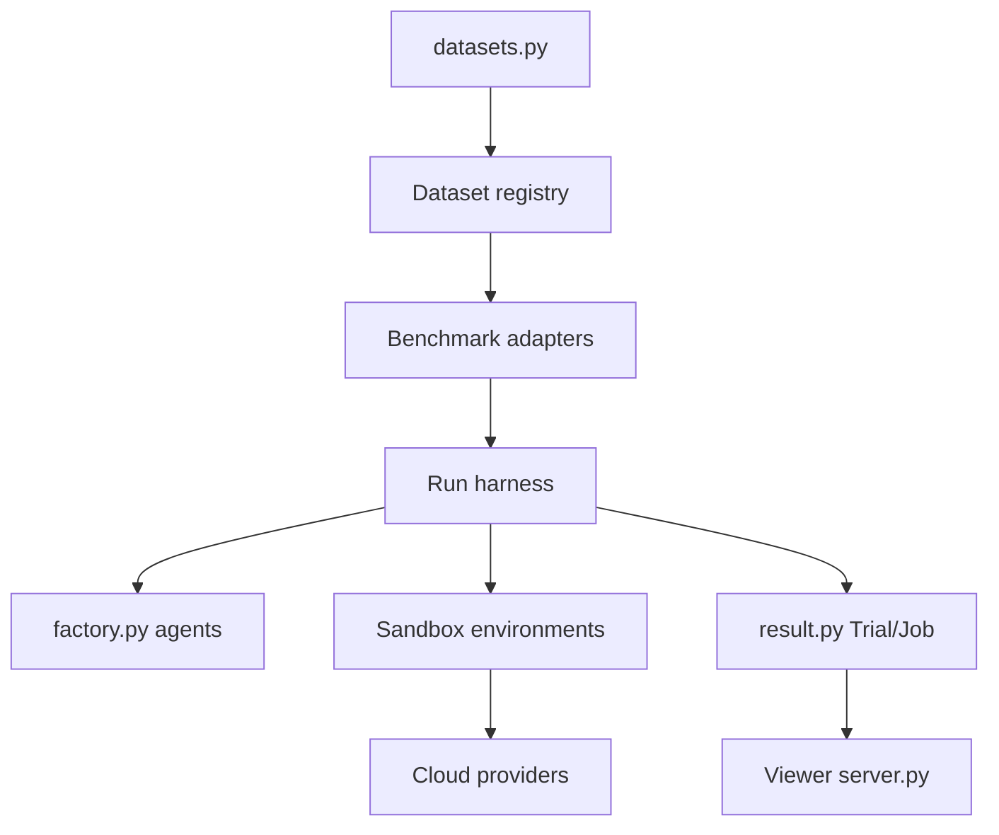

# laude-institute/harbor

> Framework for evaluating agents and models on benchmarks in parallel sandboxes, for AI engineers.

## The problem
Comparing agents (Claude Code, OpenHands, Codex CLI) on benchmarks requires sandbox and orchestration infrastructure that you have to cobble together yourself.

## What it actually does
Runs a dataset (e.g. Terminal-Bench 2.0) with a chosen agent and model, locally under Docker or on cloud providers (Daytona, Modal, etc.). Handles the dataset registry, third-party benchmark adapters (SWE-Bench, Aider Polyglot), result storage, a web viewer and rollout generation for RL.

## How it is wired


## Trying it
```bash
uv tool install harbor
export ANTHROPIC_API_KEY=<YOUR-KEY>
harbor run --dataset terminal-bench@2.0 --agent claude-code --model anthropic/claude-opus-4-1 --n-concurrent 4
harbor run --dataset terminal-bench@2.0 --agent claude-code --model anthropic/claude-opus-4-1 --n-concurrent 100 --env daytona
harbor datasets list
```

## Cost and gotchas
Model calls are billed by your provider. Parallel cloud runs require an account and a key with the sandbox provider. 964 open issues.

## What it is not
Not an agent: it is the test bench. Not a benchmark in itself, it runs others.

## Alternatives
No alternative named in the README.

## For you
Adopt it if you evaluate agents or generate RL rollouts: official Terminal-Bench harness, Apache-2.0, active (push on 2026-09-29).
