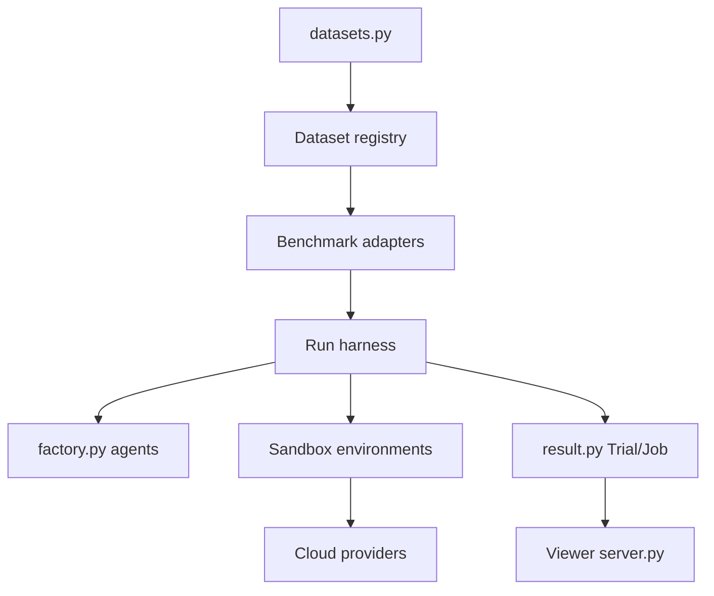

# laude-institute/harbor

> Framework pour évaluer des agents et modèles sur des benchmarks en bacs à sable parallèles, pour ingénieurs IA.

## Le problème
Comparer des agents (Claude Code, OpenHands, Codex CLI) sur des benchmarks demande une infrastructure de sandboxes et d'orchestration à bricoler soi-même.

## Ce que ça fait vraiment
Lance un jeu de données (ex. Terminal-Bench 2.0) avec un agent et un modèle choisis, en local sous Docker ou sur des fournisseurs cloud (Daytona, Modal, etc.). Gère le registre de datasets, des adaptateurs de benchmarks tiers (SWE-Bench, Aider Polyglot), le stockage des résultats, un visualiseur web et la génération de rollouts pour RL.

## Comment c'est branché


## Essayer
```bash
uv tool install harbor
export ANTHROPIC_API_KEY=<YOUR-KEY>
harbor run --dataset terminal-bench@2.0 --agent claude-code --model anthropic/claude-opus-4-1 --n-concurrent 4
harbor run --dataset terminal-bench@2.0 --agent claude-code --model anthropic/claude-opus-4-1 --n-concurrent 100 --env daytona
harbor datasets list
```

## Coût et pièges
Les appels aux modèles sont facturés par ton fournisseur. Les runs parallèles cloud demandent un compte et une clé chez le fournisseur de sandbox. 964 issues ouvertes.

## Ce que ce n'est pas
Pas un agent : c'est le banc d'essai. Pas un benchmark en soi, il en exécute d'autres.

## Alternatives
Aucune alternative nommée dans le README.

## Pour toi
À adopter si tu évalues des agents ou génères des rollouts RL : harnais officiel de Terminal-Bench, Apache-2.0, actif (push le 2026-09-29).

