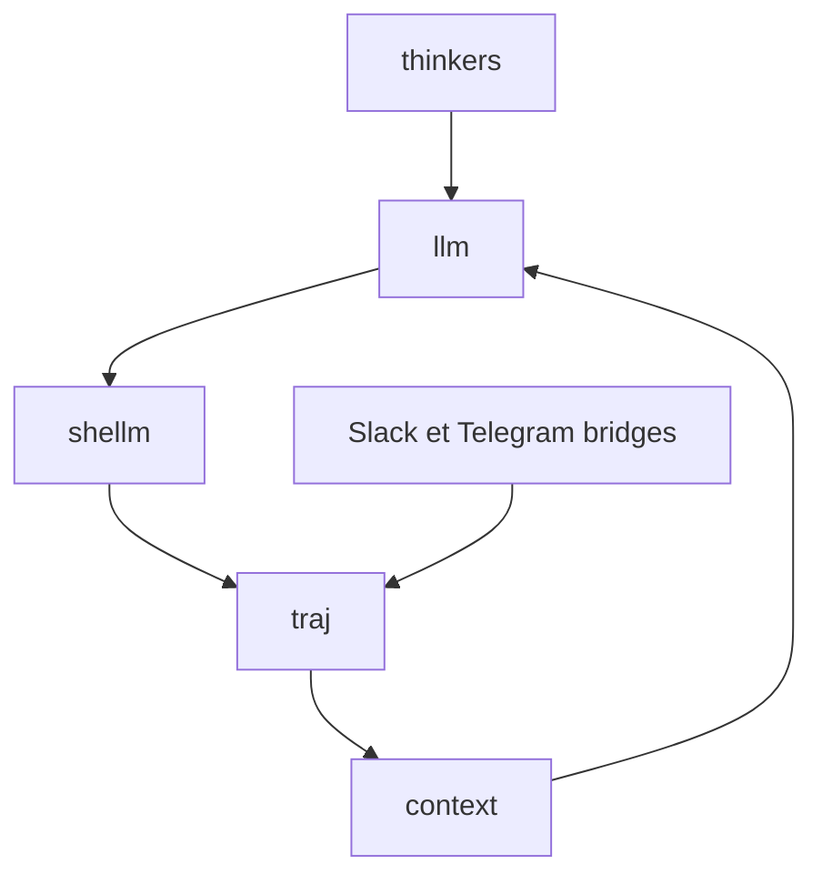

# laude-institute/headlong

> Micro agent harness in Bash, where the agent thinks continuously and receives messages as observations.

## The problem
Most agent harnesses are reactive: they wait for a request. Here, the agent keeps a thread of thought going with no external interaction.

## What it actually does
The core is about 11,000 lines of Bash. `shellm` sends the context to an LLM, executes the shell commands returned and starts over. `traj` stores the trajectory as a graph of jsonl files, and `context` compacts it in tiers. Slack, Telegram and a chat feed a single stream. A web dashboard shows the agent thinking. Docker serves as a sandbox.

## How it is wired


## Trying it
```bash
curl -fsSL https://headlong.ai/install.sh | bash
ada hello
ada dash
ada stop
```

## Cost and gotchas
The README states $1 to $2 per hour of thinking at their settings, with an API key; use a capped key. The agent runs real shell commands: prefer Docker. Alpha research software.

## What it is not
Not a stable product nor safe for secrets: what you tell the agent is shared with all its interlocutors. No tool system beyond Bash. Local models avoid the key but not the risk.

## Alternatives
No alternative named in the README.

## For you
Worth watching: the idea of context as a projection of a trajectory is interesting for anyone building agents, but it is alpha research at a continuous cost.
