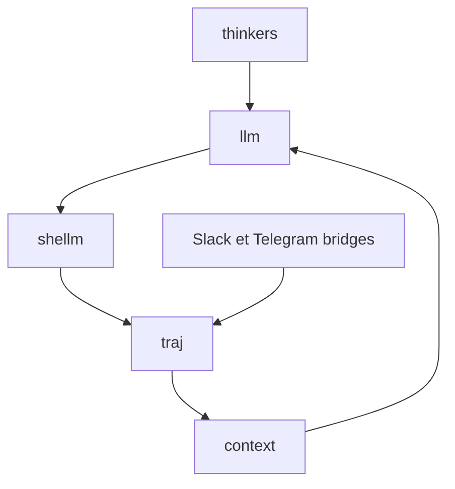

# laude-institute/headlong

> Micro-harnais d'agent en Bash, où l'agent pense en continu et reçoit les messages comme des observations.

## Le problème
La plupart des harnais d'agents sont réactifs : ils attendent une requête. Ici, l'agent garde un fil de pensée sans interaction externe.

## Ce que ça fait vraiment
Le cœur fait environ 11 000 lignes de Bash. `shellm` envoie le contexte à un LLM, exécute les commandes shell renvoyées et recommence. `traj` stocke la trajectoire en graphe de fichiers jsonl, et `context` la compacte par paliers. Slack, Telegram et un chat alimentent un seul flux. Un tableau de bord web montre l'agent penser. Docker sert de bac à sable.

## Comment c'est branché


## Essayer
```bash
curl -fsSL https://headlong.ai/install.sh | bash
ada hello
ada dash
ada stop
```

## Coût et pièges
Le README indique de 1 à 2 dollars de l'heure de réflexion à leurs réglages, avec clé d'API ; utiliser une clé plafonnée. L'agent exécute de vraies commandes shell : préférer Docker. Logiciel de recherche en alpha.

## Ce que ce n'est pas
Pas un produit stable ni sûr pour des secrets : ce que tu dis à l'agent est partagé avec tous ses interlocuteurs. Pas de système d'outils hors Bash. Les modèles locaux évitent la clé mais pas le risque.

## Alternatives
Aucune alternative nommée dans le README.

## Pour toi
À surveiller : l'idée de contexte comme projection d'une trajectoire est intéressante pour qui construit des agents, mais c'est de la recherche en alpha à coût continu.

