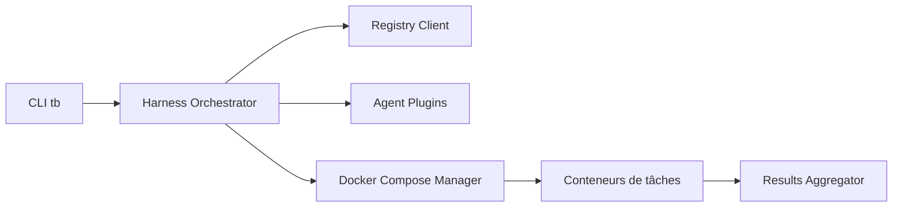

# laude-institute/terminal-bench

> Benchmark for AI agents in a real terminal: end-to-end tasks and an execution harness.

## The problem
Comparing agents on realistic system tasks (compiling, installing, training) lacks a reproducible framework.

## What it actually does
Two parts: a set of about 100 tasks (instruction in English, test script, reference solution) and a harness that connects a model to a sandboxed terminal under Docker. The `tb run` CLI launches an agent on a versioned dataset, with a public leaderboard. The project is in beta.

## How it is wired


## Trying it
```bash
uv tool install terminal-bench
tb run --help
tb run --agent terminus --model anthropic/claude-3-7-latest --dataset-name terminal-bench-core --dataset-version 0.1.1 --n-concurrent 8
```

## Cost and gotchas
Docker and `uv` required. Each evaluation consumes calls to the model provider's API, billed to you, multiplied by the number of tasks and the concurrency.

## What it is not
Not the current version: the README invites new users to move to harbor for Terminal-Bench 2.0. Not a tool for training an agent.

## Alternatives
- harbor: the new framework announced by the README to run Terminal-Bench 2.0.

## For you
Keep an eye on it: a reference for evaluating agents, but the harbor announcement indicates this repository is no longer the entry point.
