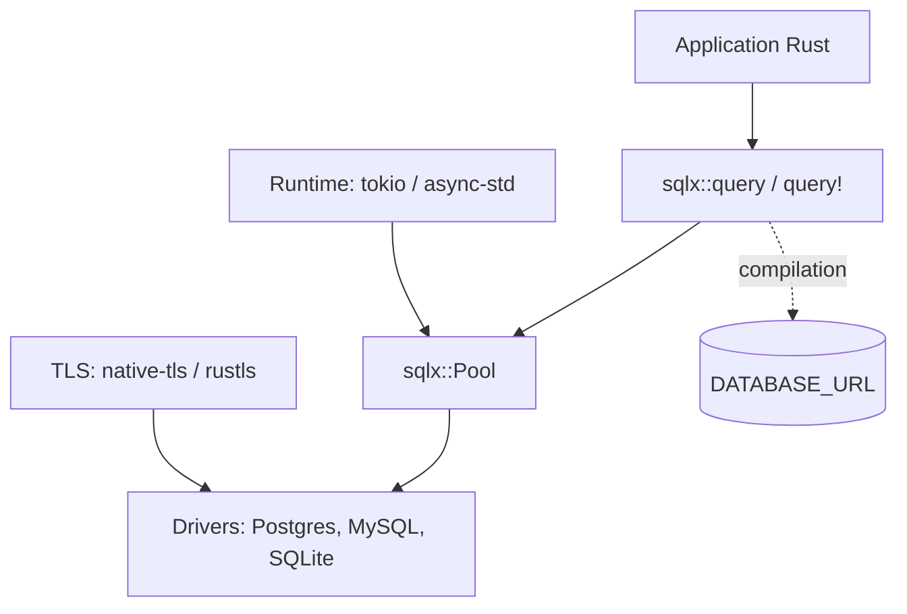

# launchbadge/sqlx

> Async SQL toolkit in Rust, with compile-time checked queries, no ORM.

## The problem
Writing raw SQL in Rust without discovering it is broken at runtime, while staying async.

## What it actually does
Async crate for PostgreSQL, MySQL/MariaDB and SQLite, with connection pooling, row streaming, prepared statement caching, nested transactions and `LISTEN/NOTIFY` for Postgres. The `query!` macros connect to the development database at compile time to validate the SQL; an offline mode exists via sqlx-cli. tokio, async-std or actix runtimes; native-tls or rustls TLS.

## How it is wired


## Trying it
```bash
# Cargo.toml
sqlx = { version = "0.9", features = [ "runtime-tokio", "tls-native-tls" ] }
# Variable pour les macros query! à la compilation
DATABASE_URL=mysql://localhost/my_database
```

## Cost and gotchas
Free. You must choose a runtime + TLS combination. The macros require `DATABASE_URL` pointing to a database with the same schema, or offline mode. MSSQL has been removed since 0.7.

## What it is not
Not an ORM: no query-builder API. SQLite uses `unsafe` code via libsqlite3.

## Alternatives
- SeaORM: async ORM if you want an object layer.
- ormx: mapping layer on top, cited by the README.

## For you
Adopt if you write Rust with a SQL database: compile-time checking helps build reliable data services.
