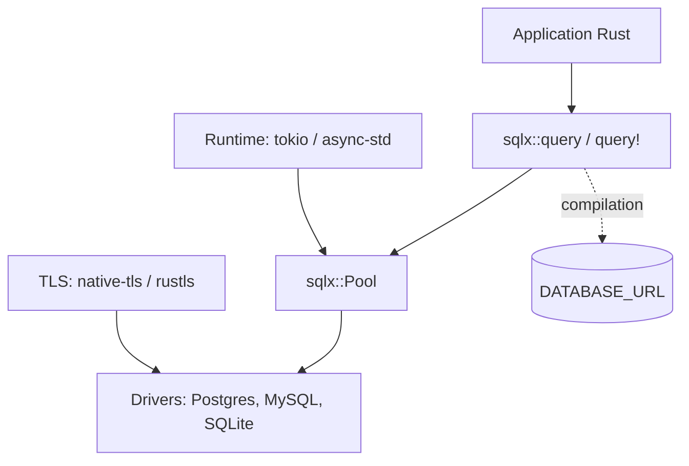

# launchbadge/sqlx

> Boîte à outils SQL asynchrone en Rust, avec requêtes vérifiées à la compilation, sans ORM.

## Le problème
Écrire du SQL brut en Rust sans le découvrir cassé à l'exécution, tout en restant asynchrone.

## Ce que ça fait vraiment
Crate asynchrone pour PostgreSQL, MySQL/MariaDB et SQLite, avec pool de connexions, streaming de lignes, cache des requêtes préparées, transactions imbriquées et `LISTEN/NOTIFY` pour Postgres. Les macros `query!` se connectent à la base de développement à la compilation pour valider le SQL ; un mode hors ligne existe via sqlx-cli. Runtimes tokio, async-std ou actix ; TLS native-tls ou rustls.

## Comment c'est branché


## Essayer
```bash
# Cargo.toml
sqlx = { version = "0.9", features = [ "runtime-tokio", "tls-native-tls" ] }
# Variable pour les macros query! à la compilation
DATABASE_URL=mysql://localhost/my_database
```

## Coût et pièges
Gratuit. Il faut choisir une combinaison runtime + TLS. Les macros exigent `DATABASE_URL` vers une base de même schéma, ou le mode hors ligne. MSSQL est retiré depuis la 0.7.

## Ce que ce n'est pas
Pas un ORM : aucune API de construction de requêtes. SQLite utilise du code `unsafe` via libsqlite3.

## Alternatives
- SeaORM : ORM asynchrone si tu veux une couche objet.
- ormx : sur-couche de mapping citée par le README.

## Pour toi
Adopter si tu fais du Rust avec une base SQL : la vérification à la compilation sert pour les services de données fiables.

