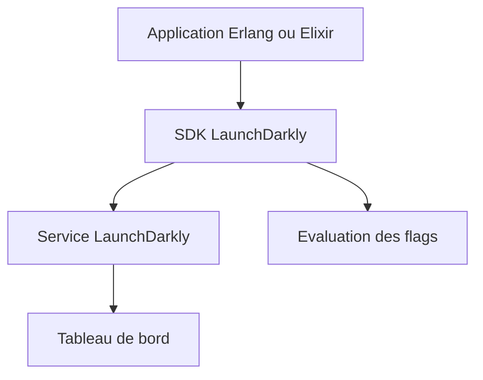

# launchdarkly/erlang-server-sdk

> Erlang and Elixir server SDK to evaluate feature flags with the LaunchDarkly platform.

## The problem
Turning a feature on or off in production without redeploying requires a flag management service.

## What it actually does
Lets an Erlang or Elixir application evaluate flags, send events and follow the update stream. Tests go through an integration harness shared by all LaunchDarkly SDKs. Installation is deferred to the reference guide: not documented in this README.

## How it is wired
Simplified diagram based on the sheet, no diagram provided.


## Trying it
```bash
# Aucune commande dans le README : voir le guide de référence du SDK.
```

## Cost and gotchas
The SDK only works with a LaunchDarkly account, a commercial platform; the README does not give the pricing. Erlang or Elixir required.

## What it is not
Not a standalone flag system: without the paid service, the SDK is useless. It does not do experimentation by itself.

## Alternatives
No alternative named in the README.

## For you
Ignore: an Erlang SDK tied to a SaaS, far from data and MLOps needs.
