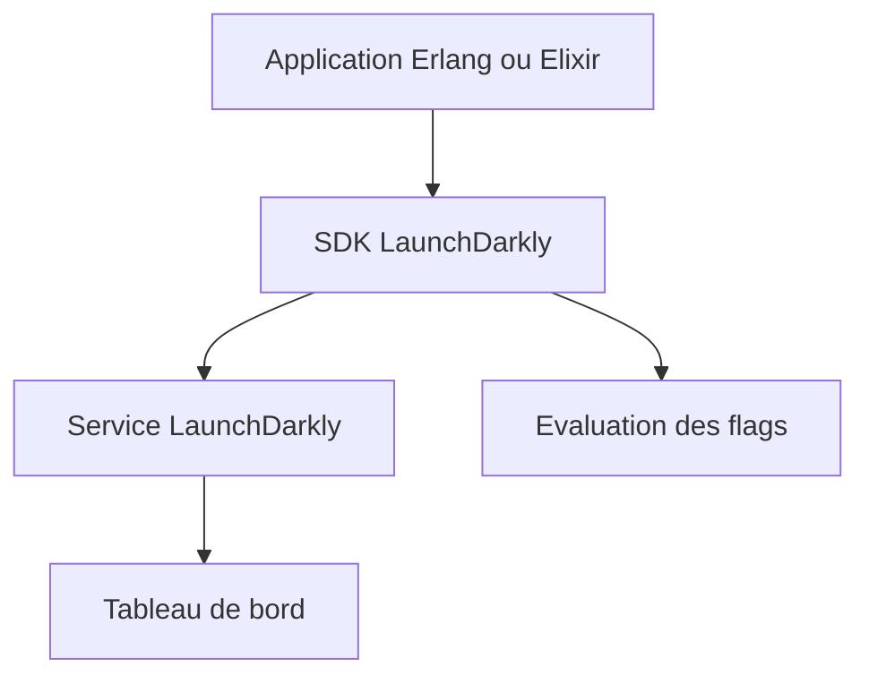

# launchdarkly/erlang-server-sdk

> SDK serveur Erlang et Elixir pour évaluer des feature flags avec la plateforme LaunchDarkly.

## Le problème
Activer ou couper une fonction en production sans redéployer demande un service de gestion de drapeaux.

## Ce que ça fait vraiment
Permet à une application Erlang ou Elixir d'évaluer des drapeaux, d'envoyer des événements et de suivre le flux de mises à jour. Les tests passent par un harnais d'intégration commun à tous les SDK LaunchDarkly. L'installation est renvoyée au guide de référence : non documentée dans ce README.

## Comment c'est branché
Schéma simplifié d'après la fiche, sans diagramme fourni.


## Essayer
```bash
# Aucune commande dans le README : voir le guide de référence du SDK.
```

## Coût et pièges
Le SDK ne fonctionne qu'avec un compte LaunchDarkly, plateforme commerciale ; le README ne donne pas la grille tarifaire. Erlang ou Elixir requis.

## Ce que ce n'est pas
Pas un système de flags autonome : sans le service payant, le SDK ne sert à rien. Il ne fait pas d'expérimentation par lui-même.

## Alternatives
Aucune alternative nommée dans le README.

## Pour toi
À ignorer : SDK pour Erlang lié à un SaaS, loin des besoins data et MLOps.

