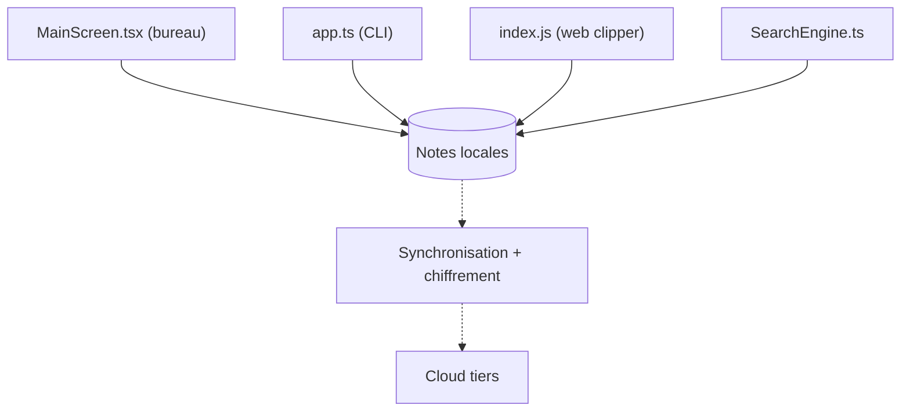

# laurent22/joplin

> A free note-taking and task management application using Markdown, with offline functionality first, followed by encrypted synchronization.

## The problem
The notes are stored in closed services (Evernote) and are difficult to synchronize without a mandatory cloud service.

## What it actually does
Desktop, mobile, and command-line applications with notebooks, tags, and full-text search. Notes are in Markdown format. End-to-end synchronization is possible via Nextcloud, Dropbox, OneDrive, or Joplin Cloud. Import Evernote and Markdown, as well as plugins and themes, and use the Firefox/Chrome web clipper.

## How it is wired

## Trying it
No documented instructions in the README: download the application from the website or app stores.

## Cost and gotchas
Free; Joplin Cloud is a separate service. Donations fund the project. The developers have not verified the synchronization engine.

## What it is not
This is not a real-time collaborative editor. The license is present, but GitHub does not recognize it: please read this before using it for commercial purposes.

## Alternatives
No alternative is specified in the README.

## For you
Excellent personal Markdown notebook, offline and encrypted; use it for taking notes after reading the license.
