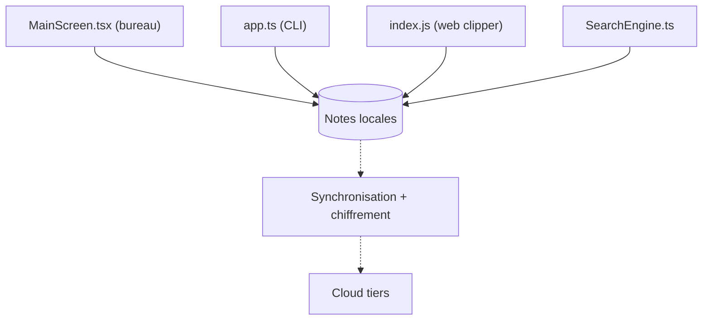

# laurent22/joplin

> Application libre de notes et de tâches en Markdown, hors ligne d'abord, avec synchronisation chiffrée.

## Le problème
Les notes sont piégées dans des services fermés (Evernote) et difficiles à synchroniser sans cloud imposé.

## Ce que ça fait vraiment
Applications bureau, mobile et CLI avec carnets, étiquettes et recherche plein texte. Les notes sont en Markdown. La synchronisation de bout en bout passe par Nextcloud, Dropbox, OneDrive ou Joplin Cloud. Import Evernote et Markdown, plugins et thèmes, web clipper Firefox/Chrome.

## Comment c'est branché

## Essayer
Aucune commande documentée dans le README : télécharger l'application depuis le site ou les boutiques.

## Coût et pièges
Gratuit ; Joplin Cloud est un service à part. Des dons financent le projet. Le graphe n'a pas vérifié le moteur de synchronisation.

## Ce que ce n'est pas
Pas un éditeur collaboratif temps réel. La licence est présente mais GitHub ne l'identifie pas : à lire avant tout usage commercial.

## Alternatives
Aucune alternative nommée dans le README.

## Pour toi
Bon carnet de notes Markdown personnel, hors ligne et chiffré ; adopte-le pour tes notes de veille, après lecture de la licence.

