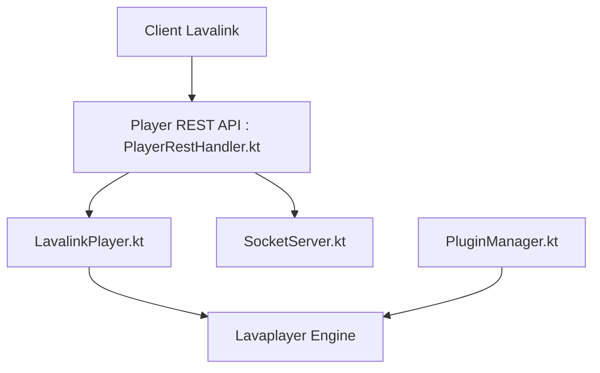

# lavalink-devs/Lavalink

> Standalone audio-sending node based on Lavaplayer, for Discord music bots.

## The problem
Sending audio from a Discord bot loads the shards; this work needs to be offloaded elsewhere.

## What it actually does
A Java server receives commands over REST and WebSocket: track loading via Lavaplayer, player control, audio filters, volume and seek. It then streams the audio to the voice service, with events, resumable sessions, statistics, Prometheus metrics and plugins. YouTube goes through a plugin.

## How it is wired

## Trying it
No command is documented in the provided README: it points to the configuration documentation and the clients. Java 17 or higher is required.

## Cost and gotchas
Free; Java 17 LTS or higher. Official support for OpenJDK or Zulu on Linux AMD64 only, other JVMs on a best-effort basis. For YouTube, a plugin must be added.

## What it is not
Not a bot: you need a client and a bot alongside it. No link to data or AI, despite the word "node".

## Alternatives
No alternative named in the README.

## For you
Ignore: an audio building block for Discord bots, unrelated to data, AI or MLOps work.
