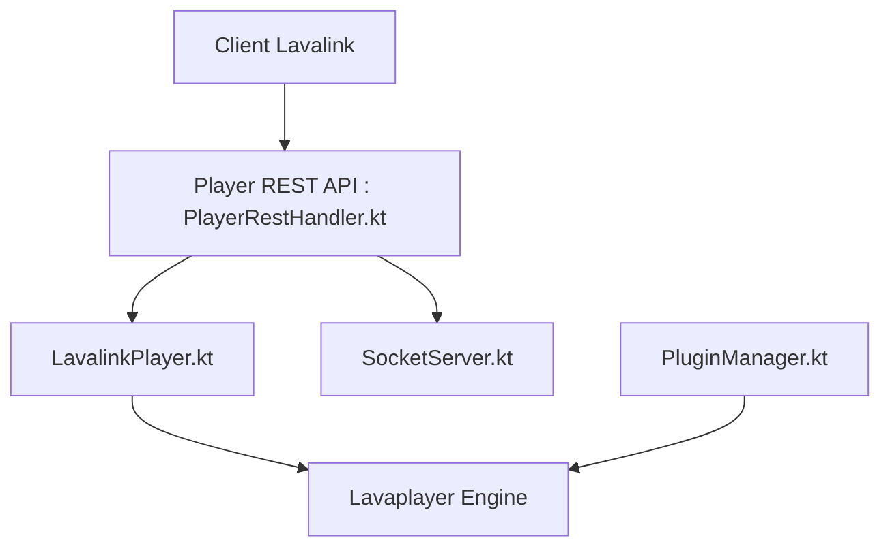

# lavalink-devs/Lavalink

> Noeud autonome d'envoi audio basé sur Lavaplayer, pour bots Discord de musique.

## Le problème
Envoyer de l'audio depuis un bot Discord charge les shards ; il faut déporter ce travail ailleurs.

## Ce que ça fait vraiment
Un serveur Java reçoit des commandes par REST et WebSocket : chargement de pistes via Lavaplayer, contrôle de lecteurs, filtres audio, volume et seek. Il diffuse ensuite l'audio vers le service vocal, avec événements, sessions reprenables, statistiques, métriques Prometheus et plugins. YouTube passe par un plugin.

## Comment c'est branché

## Essayer
Aucune commande n'est documentée dans le README fourni : il renvoie à la documentation de configuration et aux clients. Java 17 ou plus est requis.

## Coût et pièges
Gratuit ; Java 17 LTS ou plus. Support officiel d'OpenJDK ou Zulu sur Linux AMD64 seulement, les autres JVM en meilleur effort. Pour YouTube, un plugin à ajouter.

## Ce que ce n'est pas
Pas un bot : il faut un client et un bot à côté. Aucun lien avec la data ou l'IA, malgré le mot « node ».

## Alternatives
Aucune alternative nommée dans le README.

## Pour toi
À ignorer : brique audio pour bots Discord, sans rapport avec un travail data, IA ou MLOps.

