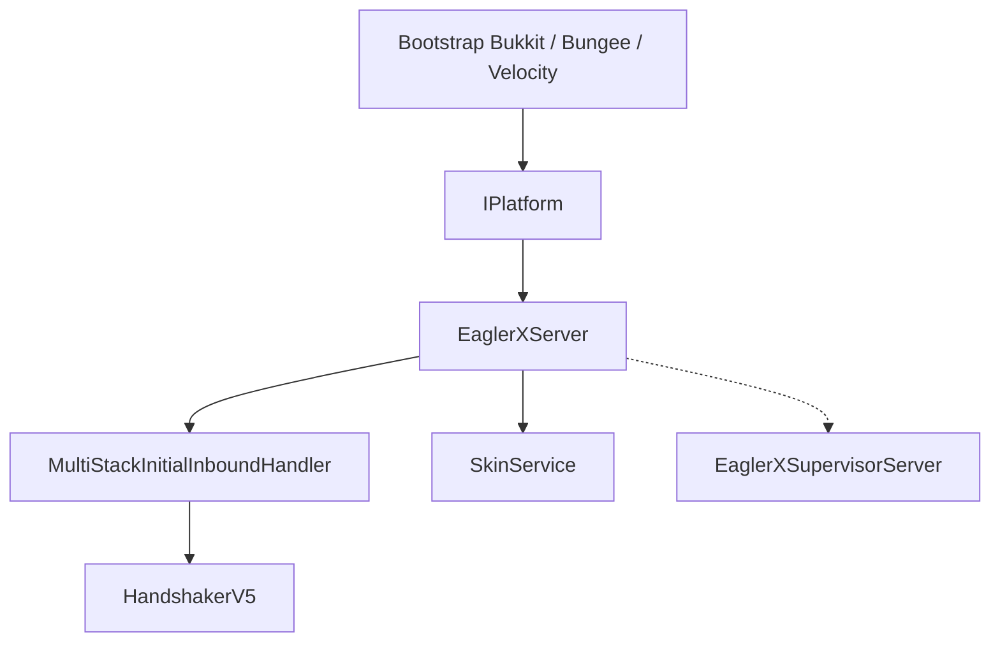

# lax1dude/eaglerxserver

> Java server plugin that lets Eaglercraft (browser) clients connect to Minecraft.

## The problem
Web Eaglercraft clients do not speak the Minecraft protocol; a translation layer is needed.

## What it actually does
A Spigot, BungeeCord or Velocity plugin injects a Netty pipeline, negotiates the WebSocket connection and translates packets. APIs for skins, voice and WebView; backend RPC; multi-proxy supervisor; optional modules (MOTD, web, 1.5).

## How it is wired


## Trying it
```bash
# Pas de commande : copier le JAR EaglerXServer dans le dossier plugins.
# API : compileOnly "net.lax1dude.eaglercraft.backend:api-bukkit:1.1.0"
```

## Cost and gotchas
Free. Java 17 minimum (not on the prerequisites list); ViaVersion is often needed.

## What it is not
Not a Minecraft crack: the README states that it does not modify authentication.

## Alternatives
No alternative named in the README.

## For you
Ignore: game server unrelated to data/AI/MLOps.
