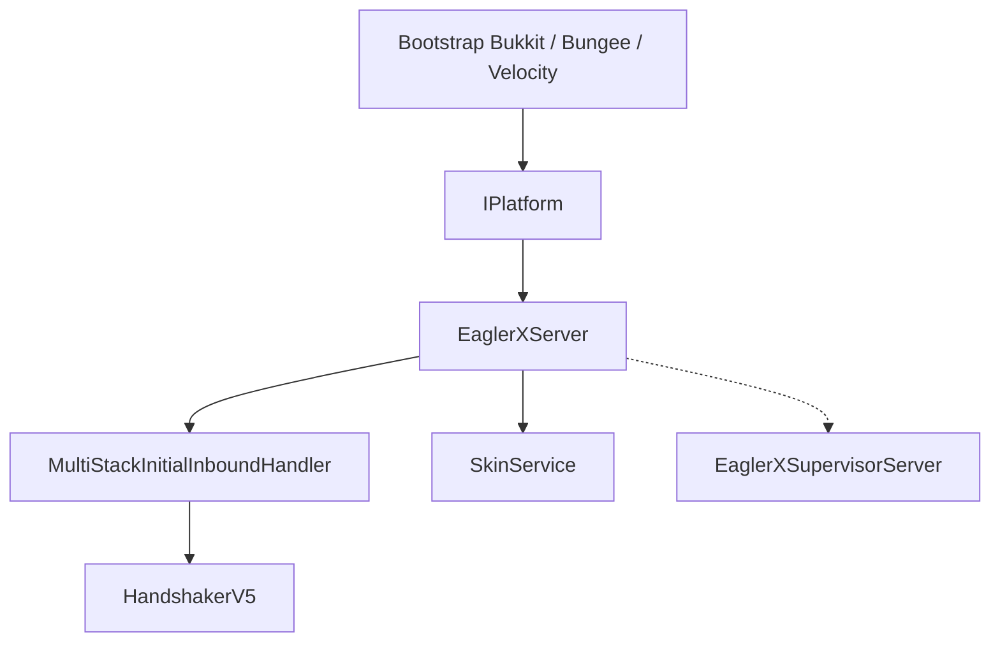

# lax1dude/eaglerxserver

> Plugin serveur Java qui permet aux clients Eaglercraft (navigateur) de se connecter à Minecraft.

## Le problème
Les clients Eaglercraft web ne parlent pas le protocole Minecraft ; il faut une couche de traduction.

## Ce que ça fait vraiment
Un plugin Spigot, BungeeCord ou Velocity injecte un pipeline Netty, négocie la connexion WebSocket et traduit les paquets. API pour skins, voix, WebView ; RPC backend ; superviseur multi-proxy ; modules optionnels (MOTD, web, 1.5).

## Comment c'est branché


## Essayer
```bash
# Pas de commande : copier le JAR EaglerXServer dans le dossier plugins.
# API : compileOnly "net.lax1dude.eaglercraft.backend:api-bukkit:1.1.0"
```

## Coût et pièges
Gratuit. Java 17 minimum (hors liste des prérequis) ; ViaVersion souvent nécessaire.

## Ce que ce n'est pas
Pas un crack de Minecraft : le README précise qu'il ne modifie pas l'authentification.

## Alternatives
Aucune alternative nommée dans le README.

## Pour toi
À ignorer : serveur de jeu sans lien avec data/IA/MLOps.

