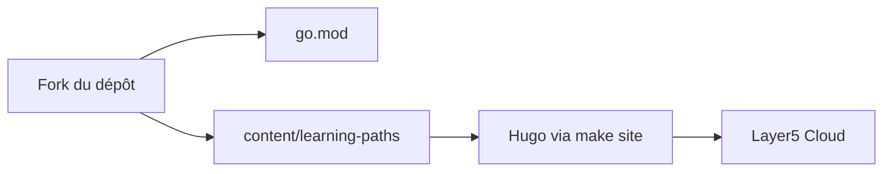

# layer5io/academy-example

> Hugo template for publishing your courses on the Layer5 Academy platform, aimed at content authors.

## The problem
Creating training paths that can be integrated into Layer5 Cloud without knowing the expected structure.

## What it actually does
A repo to fork with a learning path, course, chapter, lesson tree in Markdown, assessments described in YAML front matter, and a `Makefile` to preview locally (Hugo Extended installed by `make setup`). You need an organization ID obtained from Layer5 Cloud, then a Layer5 administrator integrates the repo.

## How it is wired
Simplified diagram based on the sheet, no diagram provided.


## Trying it
```bash
git clone https://github.com/<your-username>/academy-example.git
make setup
make site
make build
make lint
```

## Cost and gotchas
Go and Node.js required; the organization UID comes from Layer5 Cloud, and going live goes through a Layer5 administrator. The local preview does not have the final styling.

## What it is not
Not a course generator: all the content is still yours to write. Not standalone: publishing depends on the Layer5 platform.

## Alternatives
None named in the README.

## For you
Ignore: only useful if you publish on Layer5 Academy, which is not a data/AI need.
