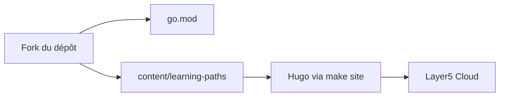

# layer5io/academy-example

> Gabarit Hugo pour publier ses cours sur la plateforme Layer5 Academy, destiné aux auteurs de contenu.

## Le problème
Créer des parcours de formation intégrables à Layer5 Cloud sans connaître la structure attendue.

## Ce que ça fait vraiment
Un dépôt à forker avec une arborescence parcours, cours, chapitre, leçon en Markdown, des évaluations décrites en front matter YAML, et un `Makefile` pour prévisualiser en local (Hugo Extended installé par `make setup`). Il faut un identifiant d'organisation obtenu auprès de Layer5 Cloud, puis un administrateur Layer5 intègre le dépôt.

## Comment c'est branché
Schéma simplifié d'après la fiche, sans diagramme fourni.


## Essayer
```bash
git clone https://github.com/<your-username>/academy-example.git
make setup
make site
make build
make lint
```

## Coût et pièges
Go et Node.js requis ; l'UID d'organisation vient de Layer5 Cloud, et la mise en ligne passe par un administrateur Layer5. L'aperçu local n'a pas le style final.

## Ce que ce n'est pas
Pas un générateur de cours : tout le contenu reste à écrire. Pas autonome : la publication dépend de la plateforme Layer5.

## Alternatives
Aucune nommée dans le README.

## Pour toi
À ignorer : utile seulement si tu publies sur Layer5 Academy, ce qui n'est pas un besoin data/IA.

