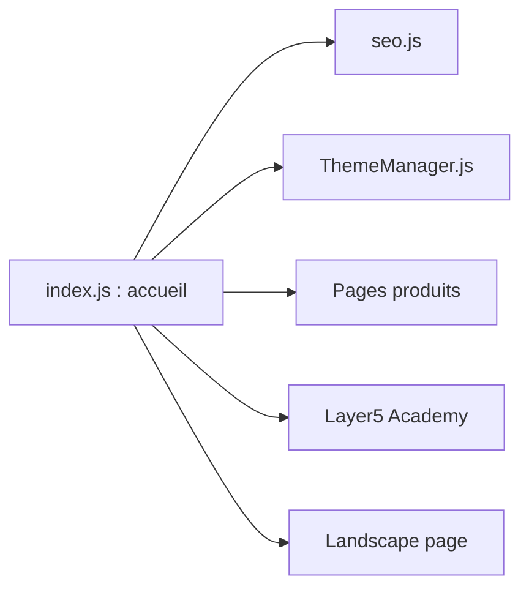

# layer5io/layer5

> Code for the website of Layer5, publisher of Meshery, Kanvas and other cloud-native projects.

## The problem
The README describes no technical problem: it is the showcase of an organization and its projects.

## What it actually does
Judging from the code, it is a Gatsby site: home page, product pages (Meshery, Kanvas, Cloud Native Catalog), community, Academy, books, and a "landscape" page comparing service meshes with a timeline. The README lists the projects (Meshery, Nighthawk, Sistent, Image Hub...) without detailing how they work.

## How it is wired

## Trying it
No command documented in the README.

## Cost and gotchas
Nothing to install for read-only use; the useful content is in the cited projects' repositories, not here. 164 open issues.

## What it is not
Not Meshery nor an infrastructure management tool: it is the marketing site. The README is a list of community links.

## Alternatives
No alternative named in the README.

## For you
Ignore: this repository is a showcase site; look at Meshery directly if service meshes interest you.
