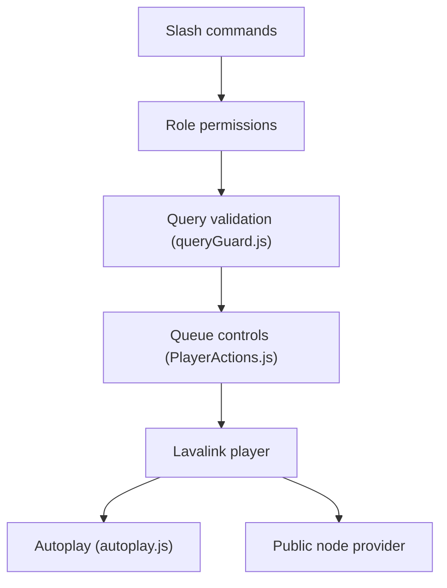

# lazaroagomez/BeatDock

> Discord music bot built on Lavalink, deployable with Docker for anyone running a Discord server.

## The problem
Public music bots disappear or limit their features; hosting your own means assembling a bot, an audio server and YouTube tokens.

## What it actually does
Slash commands (`/play`, `/search`, `/queue`, `/lyrics`, `/filter`...) playing from YouTube, SoundCloud, Bandcamp, Twitch, Vimeo; Spotify optional (resolved via YouTube). Queue, autoplay, role-based access control, 5 languages. Without a self-hosted Lavalink, it falls back to public Lavalink nodes: requests pass through them.

## How it is wired


## Trying it
```bash
mkdir beatdock && cd beatdock
# créer .env (TOKEN=...), docker-compose.yml et application.yml comme dans le README
docker compose up -d
docker compose pull && docker compose up -d --force-recreate   # mise à jour
```

## Cost and gotchas
A Discord bot token is required, with the 3 Privileged Gateway Intents. YouTube periodically blocks clients: a container generates a poToken, and the README provides a SoundCloud fallback.

## What it is not
Not a data/AI project. Age-restricted videos may remain unavailable; on public nodes, playback depends on the node operator. Modifying `application.yml` requires `--force-recreate`.

## Alternatives
No alternative named in the README (Lavalink is the underlying building block).

## For you
Watch: well documented and active, but outside your data/AI scope; useful only for a personal Discord server.
